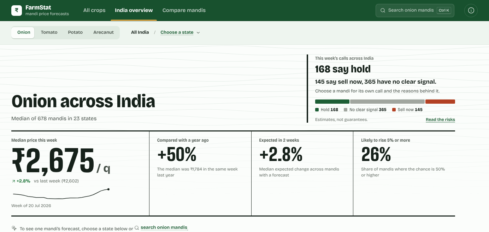
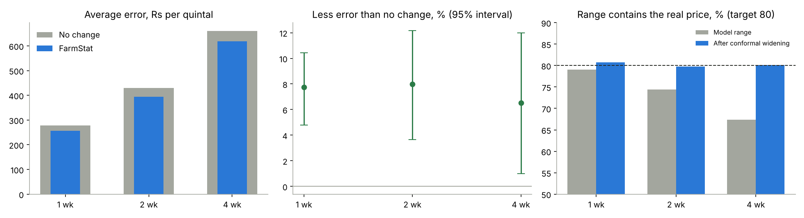
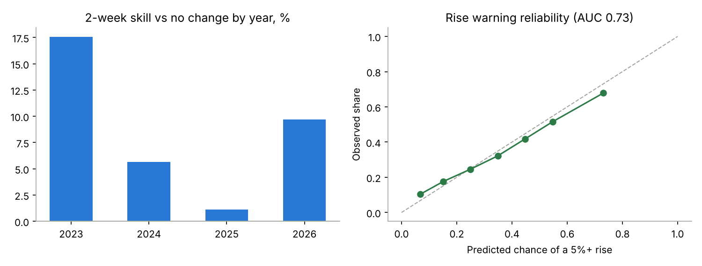
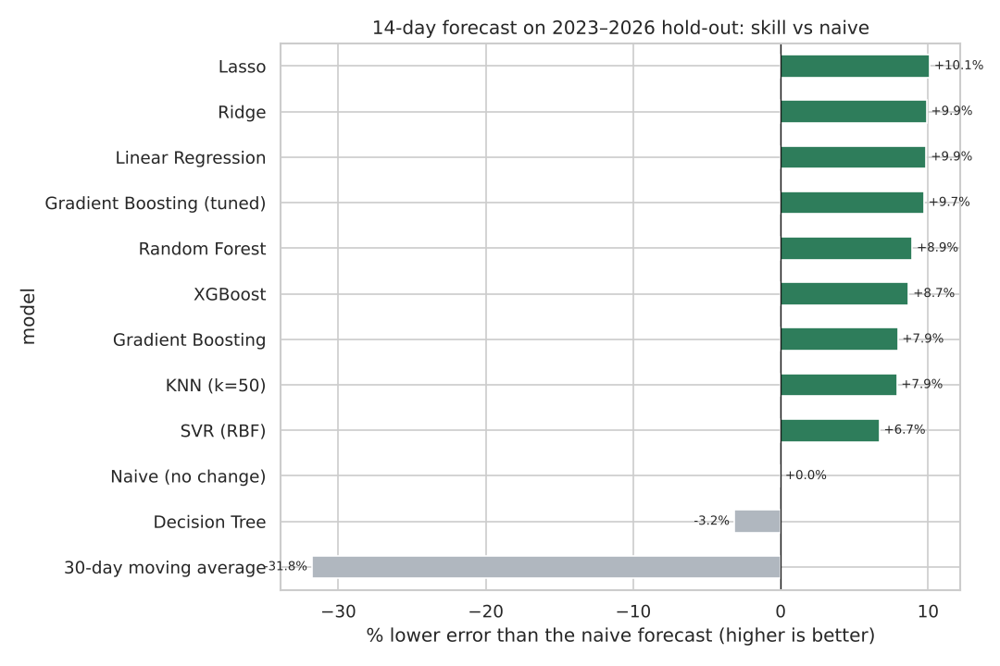
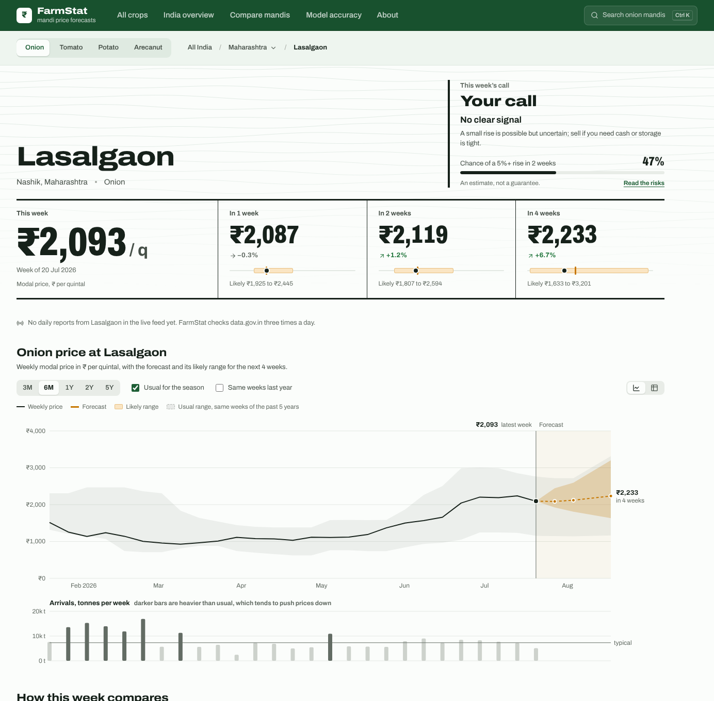
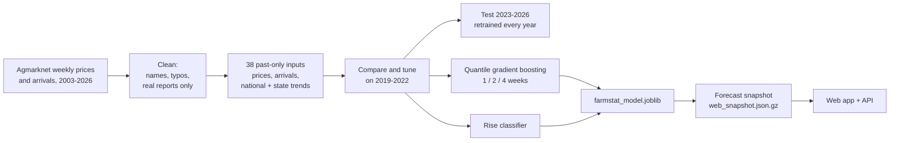
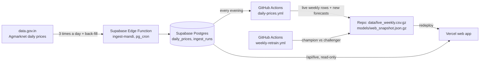
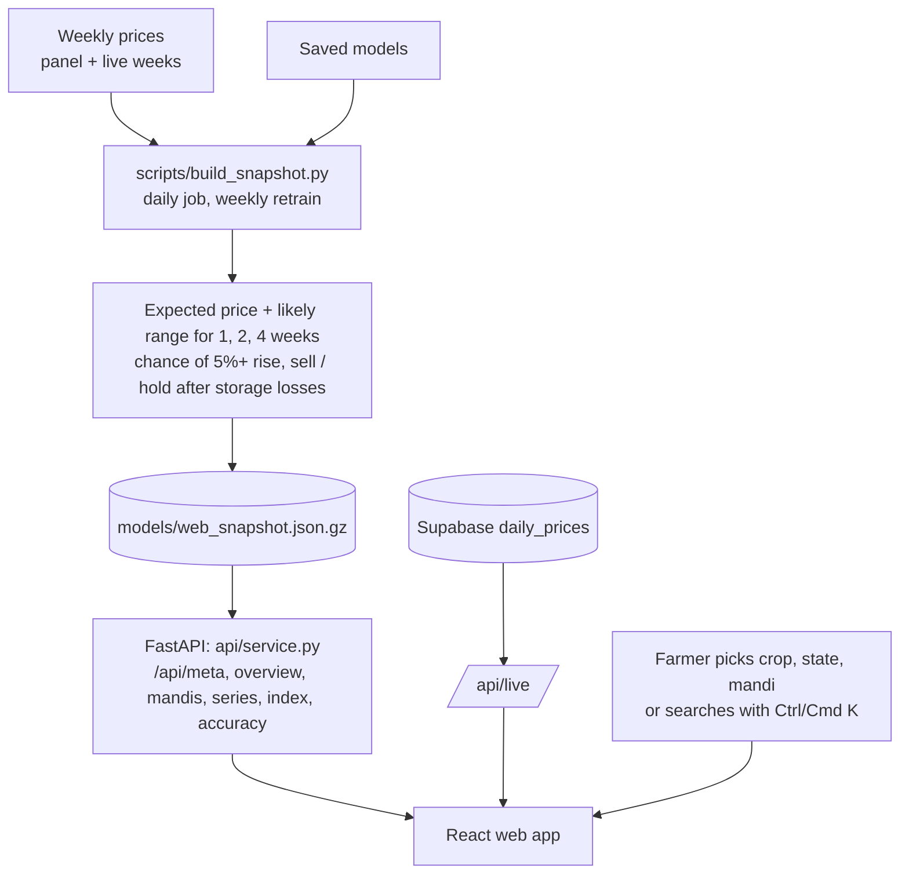

# FARMSTAT

Forecasts onion, tomato and potato prices in mandis across 24 Indian states, 1, 2 and 4 weeks ahead, tells the farmer whether to sell now or hold, and shows arecanut prices with their usual range.

<p align="center">
  
</p>

## CONTENTS

[About](#about) · [Results](#results) · [Features](#features) · [Web app](#web-app) · [How the model was built](#how-the-model-was-built) ·
[Live data](#live-data) · [Architecture](#architecture) · [Tech stack](#tech-stack) · [Getting started](#getting-started) ·
[Project structure](#project-structure) · [Data](#data) · [Status and limitations](#status-and-limitations) · [Report](#report)

## ABOUT

A farmer at the mandi has one big question: **sell this week, or wait?** Onion and tomato prices can double or
halve within a month, and most farmers decide with no forecast at all.

FarmStat learns from **23 years of weekly mandi prices and arrivals** (Agmarknet, Government of India): 625,000
weekly reports from about 980 mandis in 24 states. For each crop and mandi it gives:

- the **expected price** in 1, 2 and 4 weeks
- a **likely price range**, not just one number
- the **chance of a 5%+ price rise** in the next two weeks
- simple **sell now / hold** advice that accounts for storage losses
- a **comparison of the mandis in a state**

| Crop | Coverage | What FarmStat shows |
|---|---|---|
| Onion, tomato, potato | ~980 mandis, 24 states, weekly, 2003–2026 | Forecast 1/2/4 weeks ahead + range, rise chance, sell / hold advice |
| Arecanut | 47 mandi-variety series in Karnataka and Kerala (Sirsi, Shimoga, Yellapur, Kasargod…), weekly, 2021–2026 | Today's price with the usual range of movement (no model beat "no change"), variety-wise mandi comparison |


## RESULTS

The final test covers **January 2023 to July 2026**. The model was **re-trained at the start of each year** on past
data only, exactly as it would be in use, and these years were never used to make any modelling choice.

**At a glance** (about 170,000 forecasts per horizon; full tables in
[reports/model_evaluation.md](reports/model_evaluation.md)):

- **Beats "no change" at every horizon:** 7.7% less error at 1 week, 8.0% at 2 weeks, 6.5% at 4 weeks
- **Not luck at 1 and 2 weeks:** Diebold-Mariano p < 0.001 and p = 0.006 (at 4 weeks p = 0.14, so that gain could be chance)
- **Direction right about 2 times in 3:** 67%, 67%, 66%
- **Ranges hold as promised:** 81%, 80% and 80% of real prices fall inside the calibrated 80% range
- **Rise warning:** ROC-AUC 0.73, and its chances match reality (a predicted 45% was followed by a rise 42% of the time)
- **Following the advice paid:** +₹22 per quintal onion, +₹44 tomato, +₹11 potato vs always selling at once, after storage losses
- **Best for:** potato (11.8% less error), tomato (10.6%) and onion (8.4%) in established mandis; weakest for onion in new
  mandis (3.2% worse), which the app flags

| Forecast | Average error | Error vs "no change" forecast | Up/down right | Range contains real price |
|---|---|---|---|---|
| 1 week | ₹256 / quintal (10.8%) | **7.7% lower** | 67% | 79% |
| 2 weeks | ₹395 / quintal (16.6%) | **8.0% lower** | 67% | 74% |
| 4 weeks | ₹618 / quintal (27.1%) | **6.5% lower** | 66% | 67% |

| 2-week forecast by segment | Error vs "no change" |
|---|---|
| Onion, established mandis | 8.4% lower |
| Tomato, established mandis | 10.6% lower |
| Potato, established mandis | 11.8% lower |
| Tomato, new mandis (reporting since 2020+) | 6.2% lower |
| Onion, new mandis (reporting since 2020+) | 2.9% *higher*: hard to beat, flagged in the app |

| Other checks | Result |
|---|---|
| Price-rise classifier (5%+ in 2 weeks) | ROC-AUC 0.746. When it says 60%+ chance, a rise followed **67%** of the time, vs 35% in an average week |
| Farmer back-test (sell now vs follow the advice, after storage losses) | **+₹22 / quintal onion, +₹44 tomato, +₹11 potato**. Always holding *loses* money |

These tables come from the training notebook's test (`models/metrics.json`). The independent re-run below agrees on
the headline numbers; on small segments it differs slightly because it defines "new" as less than 3 years of history (onion in new mandis
3.2% worse, tomato in new mandis 5.5% better) and its rise classifier, trained with slightly different settings, scores ROC-AUC 0.73. "New mandis" here
means reporting since 2020; the app's "new" badge means less than 3 years of history.

"The price won't change" is a hard benchmark in any market. FarmStat beats it overall at every horizon, and in every
year from 2023 to 2026 for the 2-week forecast. The one segment where it doesn't, onion in recently added mandis, is shown openly, and the app
warns users there.

### INDEPENDENT VALIDATION

`scripts/evaluate.py` re-runs the whole yearly walk-forward test from scratch (2022 for calibration, 2023–2026 as the
test, about 168,000 mandi-weeks per horizon) and adds the checks a sceptic would ask for. Full tables:
[reports/model_evaluation.md](reports/model_evaluation.md); the web app's accuracy page shows the same results.

| Forecast | Less error than "no change" | 95% interval (block bootstrap over weeks) | Diebold-Mariano p-value | Range coverage | After conformal recalibration |
|---|---|---|---|---|---|
| 1 week | 7.7% | 4.8% to 10.4% | < 0.001 | 79.1% | 80.8% |
| 2 weeks | 8.0% | 3.6% to 12.2% | 0.006 | 74.5% | 79.8% |
| 4 weeks | 6.5% | 1.0% to 12.0% | 0.14 | 67.3% | 80.1% |

- **The gain is real at 1 and 2 weeks.** The Diebold-Mariano test (weekly average errors, Newey-West variance, Harvey
  correction) rejects "no better than no change"; at 4 weeks it does not (p = 0.14), so the 4-week forecast is a rough guide.
- **It varies by year:** 17.6% (2023), 5.7% (2024), 1.1% (2025, when hundreds of new mandis joined) and 9.7% (2026) at 2 weeks.
- **The ranges underrate falls.** The real price lands below the 10th percentile 11.6%, 14.9% and 19.5% of the time at 1, 2
  and 4 weeks (target 10%). Split-conformal calibration fixes it: each end of the range moves by the amount that
  would have left 10% of outcomes beyond it in up to 3 earlier years of out-of-sample forecasts (so the low end moves
  more). Learned only from the past, it brings each test year to 76–85% and the four years together to 80–81%. **The app
  uses these calibrated ranges** (`src/farmstat/calibration.py`, refreshed with `scripts/calibrate_ranges.py`).
- **The rise warning is honest:** ROC-AUC 0.73, Brier score 0.193 vs 0.227 for always quoting the base rate (35%); a
  predicted 45% chance was followed by a rise 42% of the time.

<p align="center">
  
  
</p>

### ARECANUT

| Crop | Test | Result |
|---|---|---|
| Arecanut | Main model, arecanut-only model and "no change", 2023–2026, retrained yearly | Neither model beat "no change" at any horizon (0.6–11% worse); weekly arecanut prices move only about 2% and behave like a random walk. Shown as today's price with the usual range, which held the real price **77–79%** of the time |

Finding out *when a model doesn't help*, and saying so, is part of the result.



## FEATURES

- **Starts with a choice, not a guess:** the first page asks which crop you are selling and shows the four crops with
  this week's India median price. Nothing is pre-selected
- **Then the crop across India:** the national median on the rate board with its 26-week trend, the change on last week
  and last year, the median expected move, how many mandis say hold or sell, prices by state, and the mandis most likely
  to rise or fall. Every row is a way in: a state opens its mandi list, a mandi opens its page
- **Then your mandi:** this week's price, the 1, 2 and 4-week forecast with its likely range, the week's call with the
  chance of a 5%+ rise, and up to five years of history
- **Search the crop's mandis** (<kbd>Ctrl</kbd>/<kbd>⌘</kbd> <kbd>K</kbd>): finds any of the chosen crop's mandis by
  mandi, district or state name, every word matched (`kolar` finds tomato in Kolar when tomato is chosen). It finds
  mandis only, never crops or pages
- **A side panel that stays out of the way:** on desktop a slim rail on the left holds the state and mandi list and
  search. Resting the pointer on it slides the list out; it closes when the pointer leaves, on a click outside, with
  <kbd>Esc</kbd> or its close button, and the pin button docks it. On phones it is a "Choose a mandi" drop-down
- Sell / hold advice that subtracts storage losses (onion 4%, potato 3%, tomato 15% per 4 weeks); tomatoes are never
  held more than a week
- **Compare mandis:** the spread of prices across a state's mandis and a sortable table of every mandi
- Warning on mandis with less than 3 years of history
- **Model accuracy page** with every test result, so users can see how far to trust the forecasts
- **Arecanut:** every mandi and variety (Rashi, Chali, Bette…), compared only with the same variety, with its usual range
  instead of a forecast
- **Readable mandi names:** Agmarknet names like `Junnar(Alephata)` are shown as "Junnar (Alephata)"; links and
  searches keep the original name

## WEB APP

A React interface on top of a FastAPI service that serves the forecasts.

<p align="center">
  
</p>

**Design.** The idea comes from the mandi's own bhav board: a white board ruled into a grid, with the day's prices in
thick condensed figures. On each page that ruled board is the one loud element (the price and its forecasts, or the four
crops on the home page); everything else sits quietly on the page, separated by space and thin rules rather than boxed
into cards.

- **Colour:** a faintly green neutral paper and ink; mandi green for the brand and "hold", brick for "sell now" and falling
  prices, and marigold (the flower strung over mandi gates) for the forecast and its likely range. The top bar and the
  icon rail are painted mandi green with the chosen page underlined in marigold, like the green-and-white boards over a
  mandi gate, and the crop bar under them is a pale wash of the same green. Built in OKLCH; text
  passes WCAG AA, and the marigold and brick pair is checked for colour-blind separation
- **Type:** one family, Archivo, along its width axis: wide for headings (signboard lettering), normal for reading,
  condensed and heavy for the big numbers, with tabular figures wherever numbers line up. One type scale for the whole
  app (a display size for the home headline, one page-title size, section and list headings, 15px reading text, 17px
  lead paragraphs, 13px labels, notes never under 12px). One variable font file
- **Motion, from [React Bits](https://reactbits.dev),** each used in one place and switched off for visitors who ask
  for reduced motion: *Waves*, laid flat as faint green field furrows behind each page's title that part around the
  pointer (drawn only while on screen, about 30 frames a second), *VariableProximity* (the home headline thickens and widens under the pointer along Archivo's
  weight and width axes; each letter keeps its resting width, so the line never rewraps), *Counter* (every digit on a
  board is a reel that rolls to its value, and from the old price to the new when you switch crop or mandi, like the
  flaps of a rate board), *SpotlightCard* (a marigold light follows the pointer across the crop board and the forecast
  cells), *BlurText* (page headings come into focus once), *ShinyText* (one sheen across the week's call) and
  *ClickSpark* (sparks when you pick a crop). All are ported to plain JavaScript and CSS without the `motion` library
  and trimmed to what FarmStat uses
- **Home page:** how FarmStat is used in three steps, then the four crops on one ruled board, each with this week's India
  median, its change on last week, the last 26 weeks and this week's hold / no clear signal / sell calls
- **Pages:** All crops (home), India overview, Compare mandis, Model accuracy and About. A mandi page has no tab of its
  own: it opens from the side panel, search, the Compare table or the overview's lists, and the "All India / state /
  mandi" bar under the top bar shows where you are. Pages that aren't about one crop (home, accuracy, about) hide the
  crop switcher, side panel and search
- **Price chart,** drawn as plain SVG: price in ink, forecast and likely range in marigold, the usual price for the season
  (10th to 90th percentile of the same weeks in the past 5 years) in grey, an optional "same weeks last year" line, and
  arrivals as bars underneath on the same time axis, heavier-than-usual weeks darker. One hover line runs through both
  with every value for that week; reporting gaps are shaded and labelled instead of bridged; 3M to 5Y ranges and a table
  view of the same numbers
- **How this week compares:** 52-week range and where today sits, change vs the same week last year, typical weekly
  move, and how prices moved in the same 4 weeks of past years. **Latest daily report** from the live feed, with a "Live"
  chip on the board when this week's price comes from it
- **Model accuracy page:** does it beat "no change" (error, 95% interval, chance it's luck, direction, average miss),
  do the likely ranges hold before and after calibration, where it works best, whether the rise warning's chances are
  honest (ROC-AUC, Brier score, reliability chart), year by year, by state, and what following the advice earned
- **About page:** method, how to read the advice, data and updates, risks, terms, privacy, licences and contact, with a
  section rail (React Bits *LineSidebar*) that follows your reading
- **Light:** the app depends only on React, an icon set and one font; charts are hand-written SVG (Recharts, about
  115 kB compressed, was removed in November 2026). All the JavaScript is about 110 kB compressed, each page loads its
  own code, the next pages' code loads while the browser is idle, and the API compresses JSON and caches built files for
  a year
- **Responsive:** on phones the mandi list folds into a drop-down, the board becomes a price row over three forecast
  cells, crop and tab rows scroll sideways with an edge fade, charts use tighter margins, and wide tables scroll
- **Links you can share, and a Back button that works:** the crop, state, mandi, page and About section are kept in the
  address bar. Each page, crop or mandi you open is a step in the browser history; the app's own corrections don't add
  steps. An old or broken link (a crop FarmStat no longer covers, an unknown mandi) opens the home page or the crop's
  overview instead of failing
- **Tested in a browser on every push:** a Playwright suite opens every page at desktop and phone size and checks the
  home page, search (mandis of the chosen crop only), the side panel, the chart tooltip, Back and Forward, fallbacks
  for broken links, and that nothing errors (`tests/e2e`)

## HOW THE MODEL WAS BUILT

Everything is in [`notebooks/FarmStat_Training.ipynb`](notebooks/FarmStat_Training.ipynb), which is saved with all its outputs.

| Step | What was done | Concept |
|---|---|---|
| Cleaning | Standardised mandi names (`APMC Azadpur` = `Azadpur`), merged Kerala/Keralam, real reports only, removed 424 typo weeks while keeping real spikes | Preprocessing, outliers |
| EDA | National price history with major shocks, number of mandis per year (the source added hundreds in 2024–25), seasonality, state price gaps, **arrivals vs next price change** | EDA |
| Features | 38 inputs from past data only: price changes over 1–52 weeks, moving averages, volatility, **arrivals** and their change vs usual, national and state trends, the mandi's usual premium, history length, season | Feature engineering |
| Validation | Compare models on 2022, GridSearch on 4 walk-forward folds, tune shrinkage on 2019–2022, final test on 2023–2026 with yearly retraining | Time-series validation |
| Classic models | Linear, Ridge, Lasso, KNN, Decision Tree, SVR vs naive and moving-average baselines | Classic models |
| Ensembles | Random Forest, Gradient Boosting, XGBoost; GridSearchCV over 8 settings × 4 folds | Ensembles, tuning |
| PCA | 23 of 36 components keep 95% of the variance; PCA + Ridge comparison | Dimensionality reduction |
| K-Means | 4 market regimes (calm, choppy, spike, crash) chosen with elbow + silhouette | Clustering |
| Classifier | Logistic Regression, Random Forest, Gradient Boosting for "5%+ rise in 2 weeks"; confusion matrix, ROC, calibration | Classification |
| Shrinkage | Forecasts pulled towards "no change" by a factor tuned on 2019–2022 | Regularisation |
| Ranges | Quantile gradient boosting (10th / 50th / 90th percentile) with coverage check, then split-conformal calibration (`scripts/calibrate_ranges.py`) | Uncertainty, conformal prediction |
| Evaluation | MAE, MAPE, skill vs naive, direction accuracy; by crop, mandi type, year and state; two case studies (Kolar tomato 2023, Lasalgaon onion export ban); farmer back-test; permutation importance | Metrics |
| Arecanut | Main model vs arecanut-only model vs naive with yearly retraining; empirical range from past moves with coverage check | Model selection, honest negatives |

**Final model:** Histogram Gradient Boosting with quantile loss (3 horizons × 3 quantiles), plus a gradient-boosting
classifier for price rises, re-trained on all data up to July 2026.



## LIVE DATA

FarmStat keeps itself up to date from the government's free mandi price API and stores everything in the cloud.



- **Collecting:** the `ingest-mandi` Edge Function (`supabase/functions/ingest-mandi`) pulls today's onion, tomato,
  potato and arecanut prices from the *Current Daily Price* resource at 16:00, 19:00 and 22:00 IST,
  and back-fills past days from the *Variety-wise Daily Market Prices* resource, newest first, until the gap since the
  history panel is closed (`backfill_queue`). Each run is logged in `ingest_runs`.
- **Forecasting:** every evening a GitHub Actions job reads the stored prices (public, read-only key), turns them into
  weekly rows that extend each mandi's history, and rebuilds the forecasts and sell / hold calls. A mandi whose live
  reports only just resumed is "warming up" until it has 4 reported weeks out of the last 13: it shows the live price
  with the usual range and no call, because the model's recent-week inputs would otherwise read as a crash.
- **Retraining:** every Monday the weekly models are retrained on history plus live weeks and kept only if they beat
  the current model on weeks neither has seen (champion / challenger), logged in `model_runs` when the
  `SUPABASE_SERVICE_KEY` repository secret is set (without it the sidebar shows no retrain date).
- **Endpoints:** `GET /api/live?crop=Onion&state=Maharashtra&market=Kolhapur` (that mandi's daily reports),
  `GET /api/live/status` (last fetch, last retrain, latest price date) and `GET /api/index` (every active series, for search).
- **API key:** without one the public sample key is used, which returns 10 records per request, so collecting is slow.
  Register a free key at [data.gov.in](https://data.gov.in) and add it as the `DATA_GOV_IN_API_KEY` secret of the
  Supabase project (Edge Functions → Secrets).
- **Arrivals** aren't in the daily feed, so live weeks have none; the models handle missing values.
- **Docs:** endpoint reference in [docs/API.md](docs/API.md); checks, back-fills, key rotation and pausing in
  [docs/RUNBOOK.md](docs/RUNBOOK.md); what to check before and after a push in [docs/DEPLOY_CHECKLIST.md](docs/DEPLOY_CHECKLIST.md);
  known debt and its priority in [docs/TECH_DEBT.md](docs/TECH_DEBT.md).
- **Security:** tables allow public reads only (row-level security); writes need the service key. The ingest function
  also requires an `x-ingest-token` header that only the project's own schedules send (the token lives in a private
  schema and is checked by a function only the service role may call), and it refuses unknown crops and back-fills
  longer than 31 days. `/api/live` only queries mandis that exist in FarmStat's data, and its cache is bounded.

## ARCHITECTURE

The models never run inside the web app. They run offline (training, the daily job and the weekly retrain), which
write one compressed snapshot of every forecast; the API serves that snapshot, so the deployed app needs no scikit-learn.



## TECH STACK

<p align="center">
  
  
  
  
  
  
  
  
</p>

| Layer | Technology |
|---|---|
| Models | scikit-learn (HistGradientBoosting, quantile loss), joblib |
| Training | Jupyter, pandas, NumPy, XGBoost, matplotlib, seaborn |
| API | FastAPI, Uvicorn |
| Web app | React 19, Vite, hand-written SVG charts, React Bits (Waves, VariableProximity, Counter, SpotlightCard, BlurText, ShinyText, ClickSpark, LineSidebar), lucide icons; Archivo (one variable font, width axis) |
| Live data | data.gov.in API, Supabase (Postgres, Edge Functions, pg_cron, pg_net), GitHub Actions |
| Hosting | Vercel (FastAPI, Python 3.12) |
| Checks | pytest, Ruff, ESLint (React and hooks rules, zero warnings), Playwright browser tests, GitHub Actions CI |

## GETTING STARTED

You need **Python 3.11+**.

```bash
git clone https://github.com/Iamshi-vissa/FarmStat.git
cd FarmStat
python -m venv .venv
source .venv/bin/activate            # Windows PowerShell: .\.venv\Scripts\Activate.ps1
pip install -r requirements-full.txt
python -m uvicorn api.main:app --port 8000
```

Open <http://localhost:8000>. The data, the trained models and the built web app are included, so Node.js isn't
needed. API documentation is at <http://localhost:8000/docs>.

The web app reads the latest forecasts from `models/web_snapshot.json.gz`, so it starts in a few seconds and only
needs the packages in `requirements.txt` (no scikit-learn). `requirements-full.txt` adds scikit-learn and
pytest for everything else. If the data or models change, the app rebuilds the snapshot on its first start (about a
minute, needs scikit-learn).

On Windows with more than one Python installed, use `py -3.12 -m venv .venv` to be sure you get the right one.

### CHANGE THE WEB APP

You need Node.js 20+. Keep the API running in one terminal, then in another:

```bash
cd web
npm install
npm run dev          # http://localhost:5173, reloads as you edit
npm run lint         # ESLint (CI fails on any warning)
npm run build        # writes web/dist, which the API serves
```

Vercel serves the committed `web/dist`, so **commit the rebuilt `web/dist` with every change to `web/src`**; CI fails
if they don't match.

How the web code is organised:

| Where | What goes there |
|---|---|
| `App.jsx` | Crop, state, mandi and page choice, the address bar, and one `page()` switch that picks the view |
| `components/*View.jsx` | One file per page (home, overview, mandi, compare, accuracy, about) |
| `components/RateBoard.jsx`, `PriceChart.jsx` | The ruled price board with the week's call, and the SVG price and arrivals chart |
| `components/Sidebar.jsx`, `Chrome.jsx` | The state and mandi panel, and the rail, hover panel and notice it sits in |
| `components/ui/` | Ported 21st.dev components (command palette, tabs) |
| `components/reactbits/` | React Bits components (FieldLines from Waves, VariableProximity, Counter, SpotlightCard, BlurText, ShinyText, ClickSpark, LineSidebar); changes from the originals are noted at the top of each file |
| `hooks.js` | `useMedia`, `useNarrow`, `useDesktop`, `useScrollEnd`, `useAppEvent`, `useWidth` (charts) |
| `events.js` | `openSearch()` and `openSidePanel()`, callable from any component |
| `storage.js` | Settings kept in the browser (pinned panel, notice seen) |
| `api.js`, `format.js`, `stats.js`, `theme.js` | API calls, number and name formatting, statistics and round axis ticks, chart colours |
| `styles.css` | Design tokens and all styles. Pages are a `.page` stack, so blocks don't set their own outer margins |

### RETRAIN THE MODEL

```bash
pip install -r requirements-train.txt
jupyter notebook notebooks/FarmStat_Training.ipynb    # Run All, about 30 minutes: model choice, tuning, final models
python scripts/build_snapshot.py                       # refresh the forecasts the web app shows
```

To refit the final models with the tuned settings (as the weekly job does) and re-run the independent test:

```bash
python scripts/retrain.py --force       # refit on all data; --force skips the champion / challenger check
python scripts/evaluate.py              # walk-forward test 2023-2026 -> reports/ (about 25 minutes, resumable)
python scripts/calibrate_ranges.py      # range calibration from the back-tests -> models/range_calibration.json
python scripts/build_snapshot.py
```

### RUN THE TESTS

```bash
pytest                                                   # data, features, forecasts and the API
FARMSTAT_E2E=1 python -m pytest tests/e2e -q             # the web app in a browser (pip install playwright;
                                                         # playwright install chromium)
```

The tests check all-India coverage, that typos are removed while real spikes are kept, that inputs use only past data
(changing future prices must not change this week's inputs), and that forecasts and advice are sane.

### UPDATE THE DATA

`scripts/prepare_data.py` rebuilds the data file from the two source extracts (see [Data](#data)). Then run
`python scripts/build_snapshot.py` and commit the new `models/web_snapshot.json.gz`.

### DEPLOY

The repo deploys to [Vercel](https://vercel.com) as it is: import it from GitHub and keep the defaults. Vercel
detects FastAPI, installs `requirements.txt` and runs `index.py`, which serves both the API and the built web app.

- The bundle is about 125 MB, well under Vercel's limit, because the deployed app reads the saved forecast snapshot
  and doesn't install scikit-learn. Keep `requirements.txt` lean; add local-only packages to `requirements-full.txt`.
- `.vercelignore` leaves the notebooks, docs, tests and web source out of the upload, so the web app must be built and
  committed (`web/dist`) before pushing.
- [docs/DEPLOY_CHECKLIST.md](docs/DEPLOY_CHECKLIST.md) lists the checks to run before and after a release.
- After retraining or updating the data, run `python scripts/build_snapshot.py` and commit the new snapshot,
  otherwise the deployed app can't build forecasts (Vercel's disk is read-only and it has no scikit-learn).

## PROJECT STRUCTURE

```
index.py                            entry point for Vercel (imports api.main:app)
api/main.py                         FastAPI app: JSON endpoints + serves the web app
api/service.py                      reads the forecast snapshot, price history and comparisons
api/livefeed.py                     read-only live daily prices and feed status from Supabase
web/src/                            React app (see "Change the web app" for its layout)
web/eslint.config.js                ESLint rules for the web app
web/dist/                           built web app
src/farmstat/data.py                load and clean the weekly prices
src/farmstat/features.py            38 leakage-free inputs and the 1/2/4-week targets
src/farmstat/forecast.py            loads the models, forecasts, shrinkage, sell/hold advice
src/farmstat/live.py                data.gov.in client, Supabase read/write, daily -> weekly rows
src/farmstat/calibration.py         split-conformal range calibration used by the forecasts
supabase/functions/ingest-mandi/    Edge Function that collects daily prices into Supabase
.github/workflows/                  CI (lint, tests, web build check, browser tests), daily forecast refresh, weekly retraining
scripts/ingest_live.py              daily job: live weekly rows + refreshed forecasts
scripts/retrain.py                  weekly job: retrain, champion vs challenger
scripts/evaluate.py                 independent validation: walk-forward, Diebold-Mariano, bootstrap, conformal, reliability
scripts/calibrate_ranges.py         learns the range calibration from the back-tests -> models/range_calibration.json
reports/                            evaluation.json and model_evaluation.md written by scripts/evaluate.py
docs/FarmStat_presentation.pptx     10-slide project presentation (generator: docs/deck/build_presentation.js)
docs/report/                        project report in IEEE format (PDF and Word)
models/farmstat_model.joblib        trained weekly models (+ arecanut ranges)
models/metrics.json                 test results
models/range_calibration.json       how far to move each end of the forecast ranges (from scripts/calibrate_ranges.py)
models/web_snapshot.json.gz         latest forecasts, advice and test results the web app shows
notebooks/FarmStat_Training.ipynb   full training and validation (with outputs)
figures/                            charts from the notebook
data/mandi_weekly.csv.gz            635,658 weekly reports: onion, tomato, potato, arecanut
data/live_weekly.csv.gz             weekly rows built from the live feed (written by the daily job)
scripts/prepare_data.py             builds the data file from the source panel
scripts/build_snapshot.py           runs the models and saves models/web_snapshot.json.gz
vercel.json, .vercelignore          Vercel deployment settings
tests/                              pytest tests (tests/e2e: browser tests, run with FARMSTAT_E2E=1)
```

## DATA

| Data | Source | Coverage |
|---|---|---|
| Weekly modal price (arrival-weighted) and arrivals | [Agmarknet](https://agmarknet.gov.in), via the [TOP Digital Twin](https://github.com/masroor01/TOP-Digital-Twin) weekly panel | Onion, tomato, potato · 24 states · ~980 mandis · Jan 2003 – Jul 2026 · real (non-imputed) weeks only |
| Daily arecanut prices by mandi and variety | Agmarknet, via [Malabar Mandi Prices](https://github.com/achuthpv/malabar-mandi-prices) | Karnataka and Kerala · Jul 2021 – Jul 2026, aggregated to weekly |
| Live daily prices (min, max, modal) | [data.gov.in](https://data.gov.in) API: *Current Daily Price of Various Commodities* and *Variety-wise Daily Market Prices* | Onion, tomato, potato, arecanut · from 21 Jul 2026, updated three times a day |

All price data is from Agmarknet, Directorate of Marketing & Inspection, Government of India, used under the
Open Government Data License – India.

## STATUS AND LIMITATIONS

- **Markets are hard to predict week to week.** The gain over "no change" is about 7–8%. That is useful, but it's not a
  crystal ball.
- **New mandis are the hardest.** Hundreds of mandis joined the data in 2024–25. With little history and sticky prices,
  onion forecasts there do not beat "no change"; the app marks these mandis with a "new" badge (less than 3 years of history) and says so next to the forecast.
- **Government decisions can't be foreseen.** Export bans and duties move prices overnight, as the Lasalgaon case study
  shows.
- **Ranges rest on the recent past.** The calibrated ranges hold the real price about 80% of the time on past years,
  but a year with bigger shocks than 2024–2026 would still push more prices outside them.
- **Potato covers only 72 mandis, in West Bengal and Uttarakhand** — the source panel only includes potato for these two states.
- **Live mandi names must match the history exactly.** About half of the mandis in today's feed match a history series;
  the rest start as new series and need a year of weeks before they're forecast.
- **Weather is not used.** Rainfall data for every mandi's district would be a natural next input.
- **Arecanut has no forecast,** only today's price with the usual range: with five years of data no model beat
  "no change". Arrival quantities aren't in the arecanut source and could help.
- **Cashew and sugarcane were dropped** in November 2026. Cashew has only monthly state averages for five states and
  its best model only tied with "no change"; sugarcane is mostly sold to mills at the government FRP, so a mandi
  forecast doesn't help. Both are in the git history.

## REPORT

The full write-up, in IEEE conference format, is in [docs/report/FarmStat_Report.pdf](docs/report/FarmStat_Report.pdf)
(editable: [FarmStat_Report.docx](docs/report/FarmStat_Report.docx)):

> **FarmStat: Probabilistic Forecasting of Weekly Mandi Prices and Sell-or-Hold Advice for Onion, Tomato and Potato in India**
> Vamshi Bharath Vissa (20241CSE1097), School of Computer Science and Engineering, Presidency University, Bengaluru

It covers the data and cleaning, the 38 features, the model comparison, quantile forecasts with shrinkage and
split-conformal calibration, the rise warning and advice rule, the 2023–2026 walk-forward test (Diebold–Mariano tests,
bootstrap intervals, results by crop, mandi type, year and state), two case studies, arecanut, a comparison with six
published Indian studies, and the limitations.

## LICENSE

MIT. See [LICENSE](LICENSE). The React Bits components in `web/src/components/reactbits/` are © David Haz under the
MIT + Commons Clause licence included in that folder.
