# FARMSTAT

Forecasts onion, tomato and potato prices in mandis across 24 Indian states, 1, 2 and 4 weeks ahead, tells the farmer whether to sell now or hold, and also covers arecanut, cashew and sugarcane.

<p align="center">
  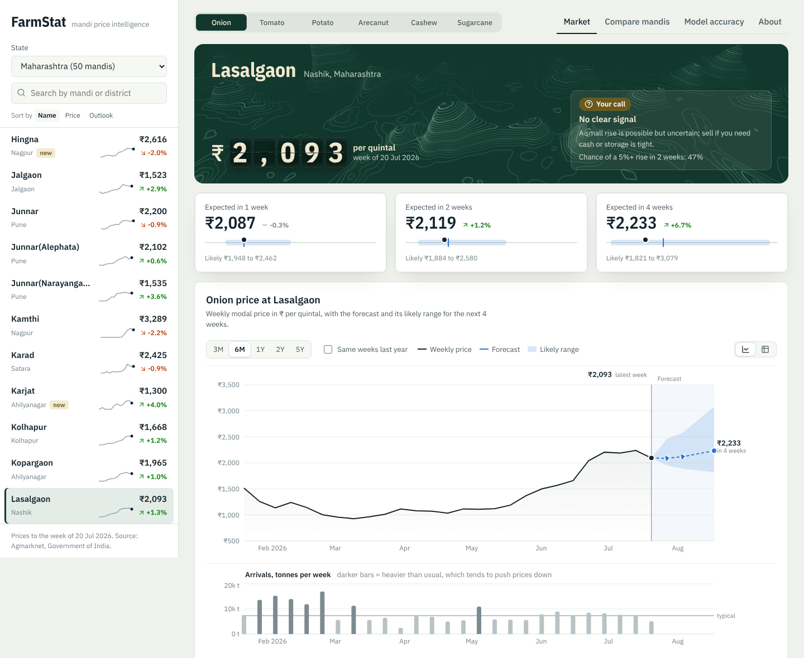
</p>

## CONTENTS

[About](#about) · [Results](#results) · [Features](#features) · [Web app](#web-app) · [How the model was built](#how-the-model-was-built) ·
[Live data](#live-data) · [Architecture](#architecture) · [Tech stack](#tech-stack) · [Getting started](#getting-started) ·
[Project structure](#project-structure) · [Data](#data) · [Status and limitations](#status-and-limitations)

## ABOUT

A farmer at the mandi has one big question: **sell this week, or wait?** Onion and tomato prices can double or
halve within a month, and most farmers decide with no forecast at all.

FarmStat learns from **23 years of weekly mandi prices and arrivals** (Agmarknet, Government of India): 625,000
weekly reports from about 980 mandis in 24 states. For each crop and mandi it gives:

- the **expected price** in 1, 2 and 4 weeks
- a **likely price range**, not just one number
- the **chance of a 5%+ price rise** in the next two weeks
- simple **sell now / hold** advice that accounts for storage losses
- a **comparison of mandis in the same state and across India**

| Crop | Coverage | What FarmStat shows |
|---|---|---|
| Onion, tomato, potato | ~980 mandis, 24 states, weekly, 2003–2026 | Forecast 1/2/4 weeks ahead + range, rise chance, sell / hold advice |
| Arecanut | 47 mandi-variety series in Karnataka and Kerala (Sirsi, Shimoga, Yellapur, Kasargod…), weekly, 2021–2026 | Today's price with the usual range of movement (no model beat "no change"), variety-wise mandi comparison |
| Cashew | 5 states, monthly state average, 2019–2026 | Rough-guide forecast 1/2/3 months ahead + calibrated range, seasonal pattern, state comparison |
| Sugarcane | Mostly sold to mills at the government FRP | FRP information (₹365/quintal for 2026–27) and the mandi price history |


## RESULTS

The final test covers **January 2023 to July 2026**. The model was **re-trained at the start of each year** on past
data only, exactly as it would be in use, and these years were never used to make any modelling choice.

| Forecast | Average error | Error vs "no change" forecast | Up/down right | Range contains real price |
|---|---|---|---|---|
| 1 week | ₹256 / quintal (10.8%) | **7.7% lower** | 67% | 79% |
| 2 weeks | ₹395 / quintal (16.6%) | **8.0% lower** | 67% | 74% |
| 4 weeks | ₹618 / quintal (27.1%) | **6.5% lower** | 66% | 67% |

| 2-week forecast by segment | Error vs "no change" |
|---|---|
| Onion, established mandis | 8.4% lower |
| Tomato, established mandis | 10.6% lower |
| Potato, established mandis | 11.8% lower |
| Tomato, new mandis (reporting since 2020+) | 6.2% lower |
| Onion, new mandis (reporting since 2020+) | 2.9% *higher*: hard to beat, flagged in the app |

| Other checks | Result |
|---|---|
| Price-rise classifier (5%+ in 2 weeks) | ROC-AUC 0.746. When it says 60%+ chance, a rise followed **67%** of the time, vs 35% in an average week |
| Farmer back-test (sell now vs follow the advice, after storage losses) | **+₹22 / quintal onion, +₹44 tomato, +₹11 potato**. Always holding *loses* money |

"The price won't change" is a hard benchmark in any market. FarmStat beats it overall at every horizon, and in every
year from 2023 to 2026 for the 2-week forecast. The one segment where it doesn't, onion in recently added mandis, is shown openly, and the app
warns users there.

### ARECANUT, CASHEW AND SUGARCANE

| Crop | Test | Result |
|---|---|---|
| Arecanut | Main model, arecanut-only model and "no change", 2023–2026, retrained yearly | Neither model beat "no change" at any horizon (0.6–11% worse); weekly arecanut prices move only about 2% and behave like a random walk. Shown as today's price with the usual range, which held the real price **77–79%** of the time |
| Cashew | Naive, Ridge and gradient boosting on monthly state data, chosen on 2022–23, tested on 2024–26 | Gradient boosting chosen (11.5% vs 11.7% average error on validation). On the test it **roughly ties with "no change"**: 13.7% vs 13.7% at 1 month, 22.3% vs 22.0% at 2, 25.0% vs 26.4% at 3. Shown as a rough guide |
| Sugarcane | — | Not forecast: mills pay the government FRP, and the mandi data is too thin |

Finding out *when a model doesn't help*, and saying so, is part of the result.

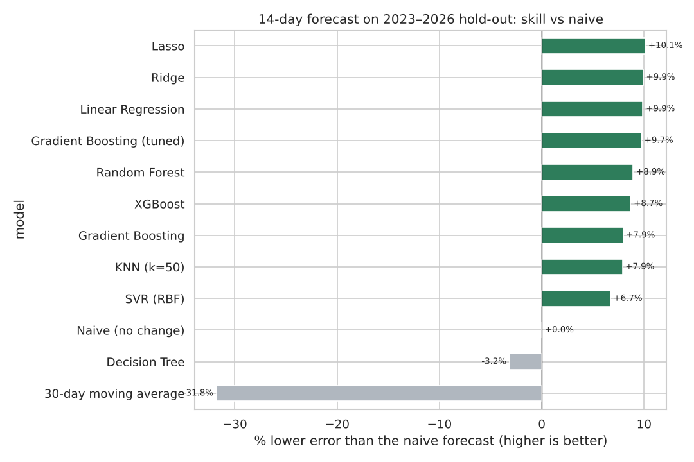

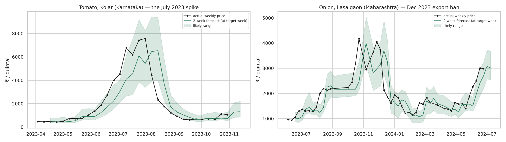

## FEATURES

- Pick a crop, a **state** and a **mandi** to see this week's price, the 1/2/4-week forecast and two years of history
  with the forecast range
- Sell / hold advice that subtracts storage losses (onion 4%, potato 3%, tomato 15% per 4 weeks)
- Never advises holding tomatoes for more than a week, because they spoil
- Shows the money involved for your quantity in quintals
- Arrivals chart for every mandi
- Compare tab with every mandi in the chosen state, the median price in each state, and the highest-paying mandis in India
- Warning on mandis with less than 3 years of history
- Accuracy tab with the test results, so users can see how far to trust the forecasts
- **Arecanut:** every mandi and variety (Rashi, Chali, Bette…), compared only with the same variety
- **Cashew page:** monthly state price, rough-guide forecast with range, seasonal pattern, all-state comparison
- **Sugarcane page:** current FRP with the recovery premium rules, and the price history

## WEB APP

An analytical web interface built with React, using [React Bits](https://reactbits.dev) components, on top of a
FastAPI service that serves the models.

- **Mandi rate board:** the current price on split-flap tiles (React Bits *SplitFlapText*) over a contour-map
  background (*Topography*) on a forest-green board, like the price boards in a mandi
- **Advice slip (parchi):** the week's sell / hold call on an opaque paper slip pinned to the board, with animated paper
  grain (*Noise*), a light that follows the pointer, a stamped verdict and the chance of a 5%+ rise
- **Crop switcher** with a sliding forest-green thumb, **forecast tiles** with a range bar for each horizon
  (*SpotlightCard*), and accuracy figures that count up when they scroll into view
- **Searchable mandi list** with a 12-week sparkline and expected change for every mandi, sortable by name, price or outlook
- **Price chart:** history with a soft wash, a shaded forecast zone with the median and likely range, a band showing the
  usual price for the season (10th to 90th percentile of the same weeks in the past 5 years), labelled latest and 4-week
  prices, round axis values, 3M / 6M / 1Y / 2Y / 5Y ranges, an optional "same weeks last year" line, gaps in reporting
  shaded and labelled instead of bridged, and a table view of the same numbers
- **Live daily reports:** for every mandi in the live feed, the latest report and its date, that day's lowest-to-highest
  lot, the change since the previous report, and a chart of the last 45 days; a "Live" chip on the rate board and the
  feed's freshness in the sidebar
- **Price statistics:** 52-week range and where today sits, change vs the same week last year, typical weekly move, how
  prices moved in the same 4 weeks of past years, the seasonal pattern by month, and the distribution of the last 3 years
- **Arrivals chart** under the price chart on the same time axis, with hover synced between the two and heavier-than-usual
  weeks shaded darker
- **More charts:** state medians, cashew seasonality, and sugarcane price vs FRP, all with hover tooltips
- **About page:** overview, method, how to read the advice, data and updates, accuracy, a risk table, terms of use,
  disclaimer, privacy, licences and contact, with a section rail (*LineSidebar*) that follows your reading
- **Colour:** forest-green and neutral ramps graded in OKLCH, so each step looks evenly lighter or darker; every text
  colour passes WCAG AA, and the chart pair (blue forecast, orange fall) is checked for colour-blind separation
- **Type, one face per job:** Bricolage Grotesque for headlines, Archivo for the interface and tables, Big Shoulders Display
  for big numbers and the rate board, Newsreader for the paper slip and the About page
- **Fast:** each page loads its own code, the charting library loads in parallel with the board, the contour map is drawn
  once in WebGL and kept as an image, the API compresses JSON (32 kB to 7 kB for a mandi list) and the built files are
  cached for a year. The first screen needs 86 kB of compressed JavaScript and shows the board in about half a second
- **Responsive:** on phones the mandi list folds into a drop-down under the header, crop and tab rows scroll sideways,
  charts use tighter margins, and wide tables scroll inside their panel
- **Small things:** a one-time notice that prices are estimates, links to the terms and risks from every page,
  <kbd>/</kbd> to search mandis, loading skeletons, and a skip link for keyboard users
- **Links you can share:** the crop, state, mandi, tab and About section are kept in the address bar

<p align="center">
  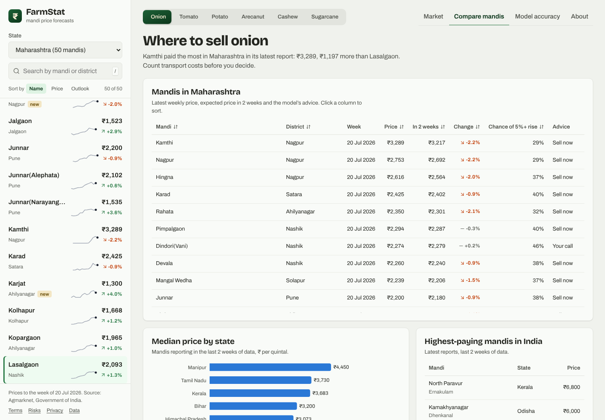
  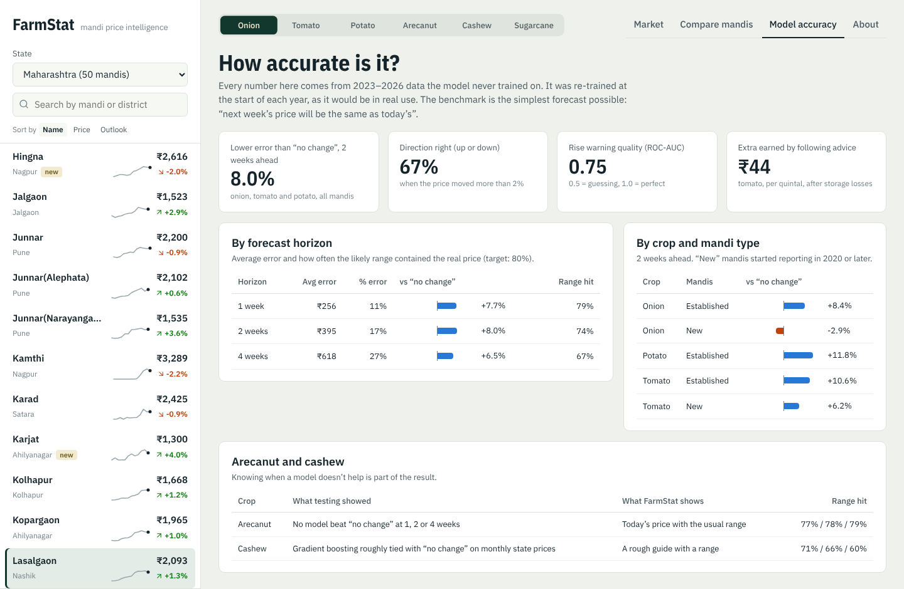
</p>
<p align="center">
  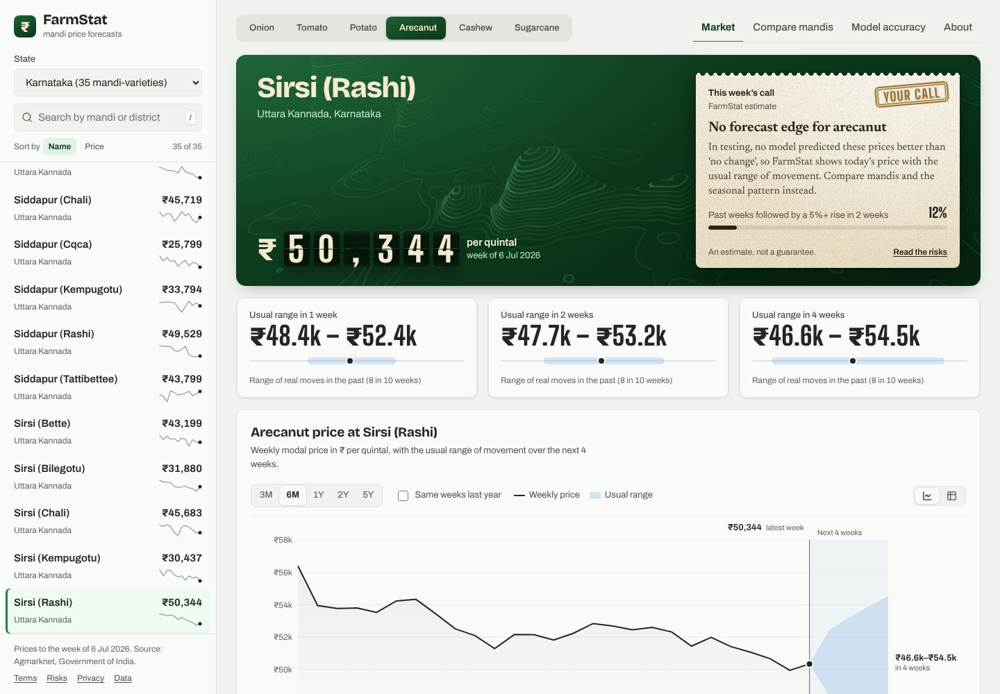
  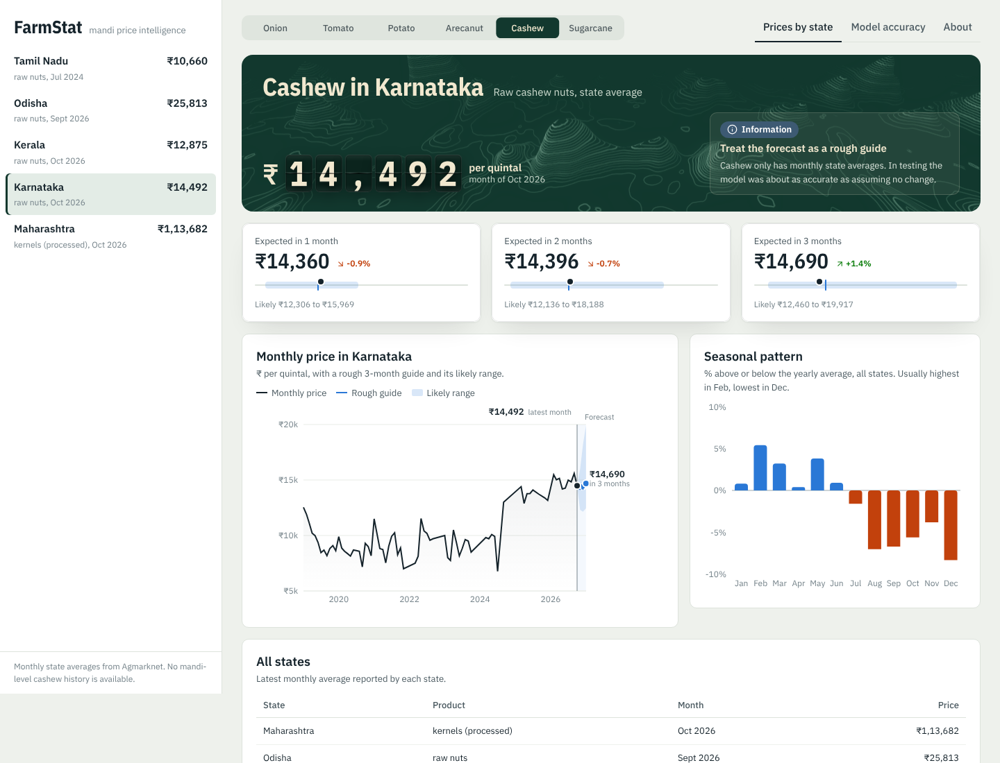
</p>
<p align="center">
  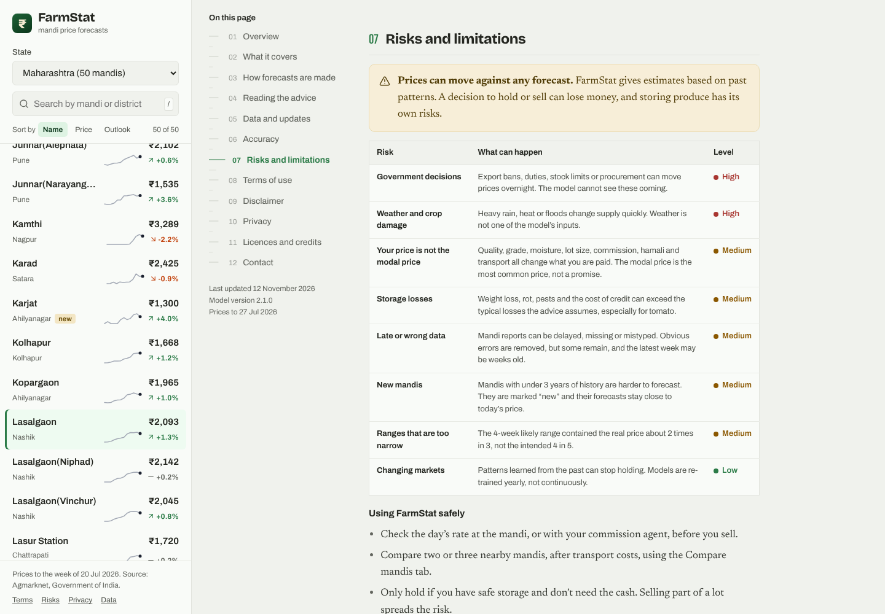
  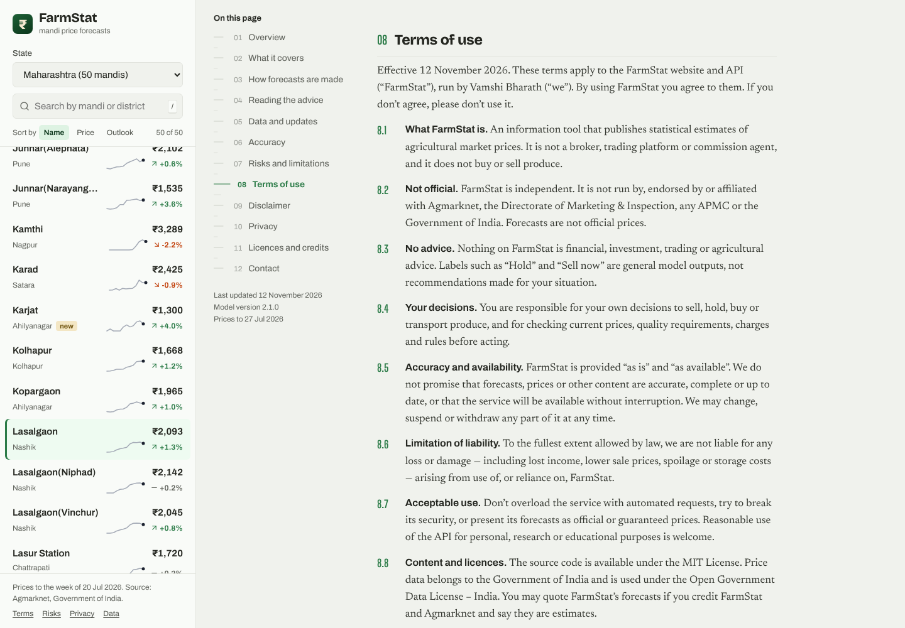
</p>
<p align="center">
  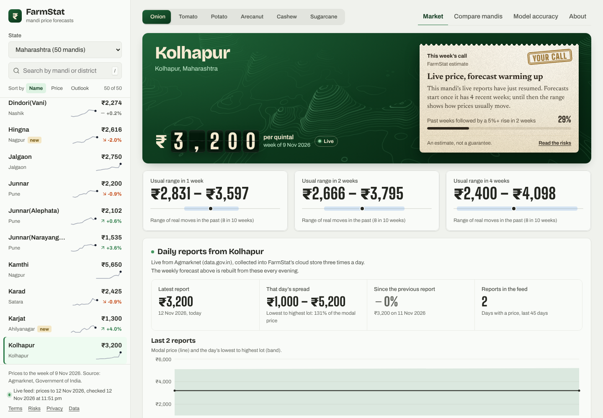
  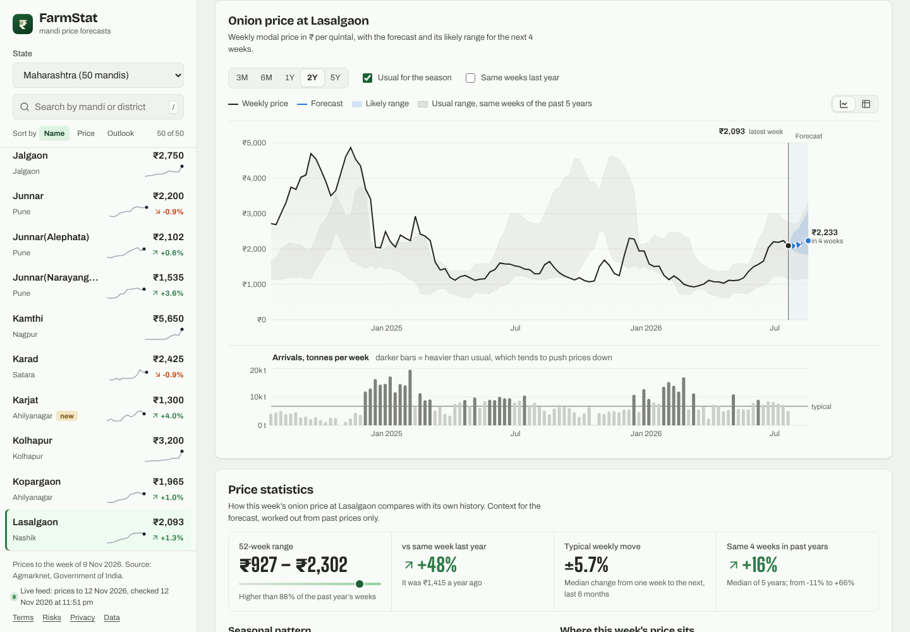
</p>
<p align="center">
  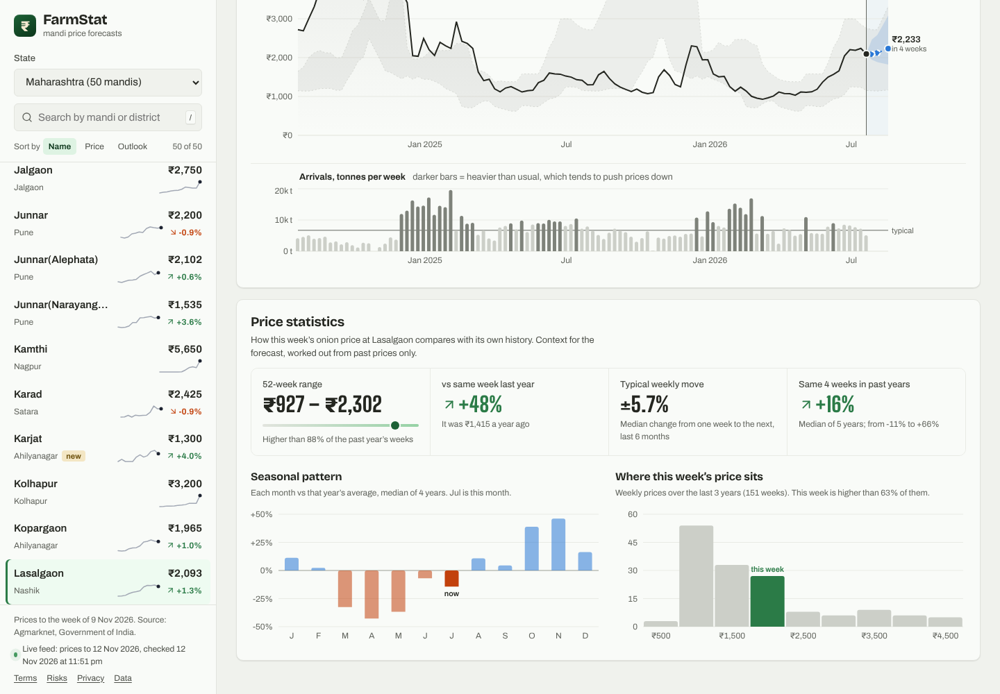
</p>
<p align="center">
  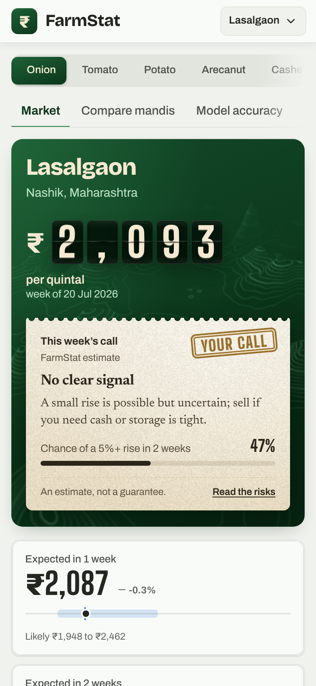
</p>

The original Streamlit app (`streamlit_app.py`) still works as a simpler alternative.

## HOW THE MODEL WAS BUILT

Everything is in [`notebooks/FarmStat_Training.ipynb`](notebooks/FarmStat_Training.ipynb), which is saved with all its outputs.

| Step | What was done | Concept |
|---|---|---|
| Cleaning | Standardised mandi names (`APMC Azadpur` = `Azadpur`), merged Kerala/Keralam, real reports only, removed 424 typo weeks while keeping real spikes | Preprocessing, outliers |
| EDA | National price history with major shocks, number of mandis per year (the source added hundreds in 2024–25), seasonality, state price gaps, **arrivals vs next price change** | EDA |
| Features | 38 inputs from past data only: price changes over 1–52 weeks, moving averages, volatility, **arrivals** and their change vs usual, national and state trends, the mandi's usual premium, history length, season | Feature engineering |
| Validation | Compare models on 2022, GridSearch on 4 walk-forward folds, tune shrinkage on 2019–2022, final test on 2023–2026 with yearly retraining | Time-series validation |
| Classic models | Linear, Ridge, Lasso, KNN, Decision Tree, SVR vs naive and moving-average baselines | Classic models |
| Ensembles | Random Forest, Gradient Boosting, XGBoost; GridSearchCV over 8 settings × 4 folds | Ensembles, tuning |
| PCA | 23 of 36 components keep 95% of the variance; PCA + Ridge comparison | Dimensionality reduction |
| K-Means | 4 market regimes (calm, choppy, spike, crash) chosen with elbow + silhouette | Clustering |
| Classifier | Logistic Regression, Random Forest, Gradient Boosting for "5%+ rise in 2 weeks"; confusion matrix, ROC, calibration | Classification |
| Shrinkage | Forecasts pulled towards "no change" by a factor tuned on 2019–2022 | Regularisation |
| Ranges | Quantile gradient boosting (10th / 50th / 90th percentile) with coverage check | Uncertainty |
| Evaluation | MAE, MAPE, skill vs naive, direction accuracy; by crop, mandi type, year and state; two case studies (Kolar tomato 2023, Lasalgaon onion export ban); farmer back-test; permutation importance | Metrics |
| Arecanut | Main model vs arecanut-only model vs naive with yearly retraining; empirical range from past moves with coverage check | Model selection, honest negatives |
| Cashew | Naive vs Ridge vs gradient boosting on monthly state data, monthly retraining, split-conformal ranges | Small-data modelling, conformal prediction |
| Sugarcane | FRP vs mandi price chart | Domain knowledge |

**Final model:** Histogram Gradient Boosting with quantile loss (3 horizons × 3 quantiles), plus a gradient-boosting
classifier for price rises, re-trained on all data up to July 2026.

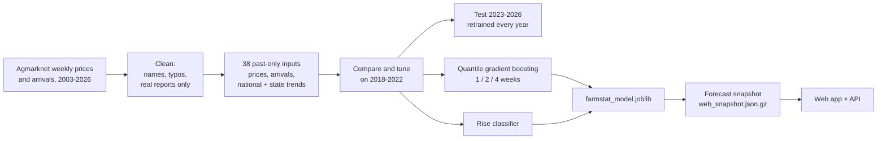

## LIVE DATA

FarmStat keeps itself up to date from the government's free mandi price API and stores everything in the cloud.

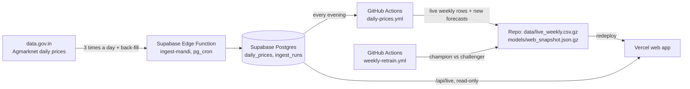

- **Collecting:** the `ingest-mandi` Edge Function (`supabase/functions/ingest-mandi`) pulls today's onion, tomato,
  potato, arecanut, cashew and sugarcane prices from the *Current Daily Price* resource at 16:00, 19:00 and 22:00 IST,
  and back-fills past days from the *Variety-wise Daily Market Prices* resource, newest first, until the gap since the
  history panel is closed (`backfill_queue`). Each run is logged in `ingest_runs`.
- **Forecasting:** every evening a GitHub Actions job reads the stored prices (public, read-only key), turns them into
  weekly rows that extend each mandi's history, and rebuilds the forecasts and sell / hold calls. A mandi whose live
  reports only just resumed is "warming up" until it has 4 reported weeks out of the last 13: it shows the live price
  with the usual range and no call, because the model's recent-week inputs would otherwise read as a crash.
- **Retraining:** every Monday the weekly models are retrained on history plus live weeks and kept only if they beat
  the current model on weeks neither has seen (champion / challenger), logged in `model_runs`.
- **Endpoints:** `GET /api/live?crop=Onion&state=Maharashtra&market=Kolhapur` (that mandi's daily reports) and
  `GET /api/live/status` (last fetch, last retrain, latest price date).
- **API key:** without one the public sample key is used, which returns 10 records per request, so collecting is slow.
  Register a free key at [data.gov.in](https://data.gov.in) and add it as the `DATA_GOV_IN_API_KEY` secret of the
  Supabase project (Edge Functions → Secrets).
- **Arrivals** aren't in the daily feed, so live weeks have none; the models handle missing values.

## ARCHITECTURE

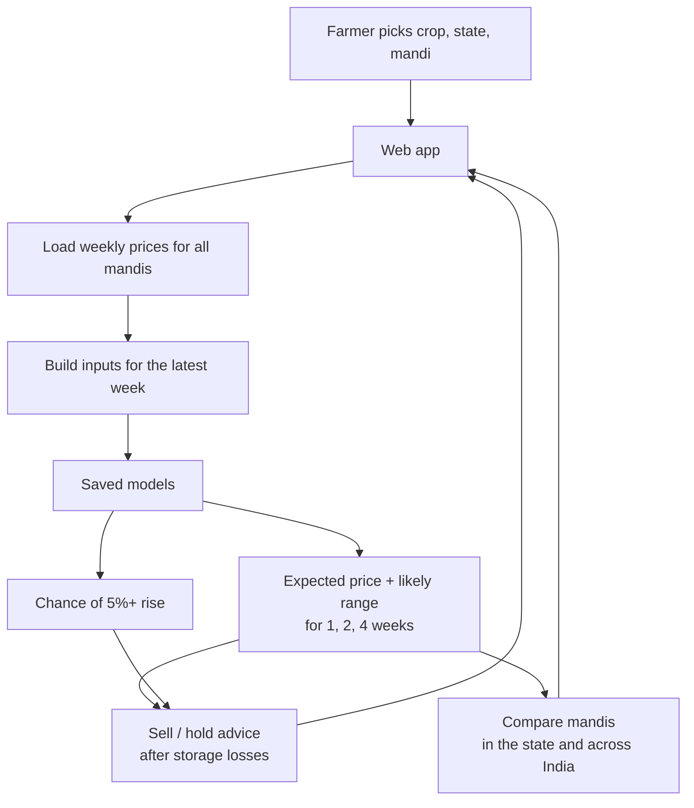

## TECH STACK

<p align="center">
  
  
  
  
  
  
  
  
  
</p>

| Layer | Technology |
|---|---|
| Models | scikit-learn (HistGradientBoosting, quantile loss), joblib |
| Training | Jupyter, pandas, NumPy, XGBoost, matplotlib, seaborn |
| API | FastAPI, Uvicorn |
| Web app | React 19, Vite, Recharts, React Bits (SplitFlapText, Topography, Noise, LineSidebar, SpotlightCard); Bricolage Grotesque, Archivo, Big Shoulders Display, Newsreader |
| Simple app | Streamlit, Plotly |
| Live data | data.gov.in API, Supabase (Postgres, Edge Functions, pg_cron, pg_net), GitHub Actions |
| Hosting | Vercel (FastAPI, Python 3.12) |
| Tests | pytest |

## GETTING STARTED

You need **Python 3.11+**.

```bash
git clone https://github.com/Iamshi-vissa/FarmStat.git
cd FarmStat
python -m venv .venv
source .venv/bin/activate            # Windows PowerShell: .\.venv\Scripts\Activate.ps1
pip install -r requirements-full.txt
python -m uvicorn api.main:app --port 8000
```

Open <http://localhost:8000>. The data, the trained models and the built web app are included, so Node.js isn't
needed. API documentation is at <http://localhost:8000/docs>.

The web app reads the latest forecasts from `models/web_snapshot.json.gz`, so it starts in a few seconds and only
needs the packages in `requirements.txt` (no scikit-learn). `requirements-full.txt` adds scikit-learn, Streamlit and
pytest for everything else. If the data or models change, the app rebuilds the snapshot on its first start (about a
minute, needs scikit-learn).

To use the simpler Streamlit app instead: `streamlit run streamlit_app.py`, then open <http://localhost:8501>.

On Windows with more than one Python installed, use `py -3.12 -m venv .venv` to be sure you get the right one.

### CHANGE THE WEB APP

You need Node.js 20+. Keep the API running in one terminal, then in another:

```bash
cd web
npm install
npm run dev          # http://localhost:5173, reloads as you edit
npm run build        # writes web/dist, which the API serves
```

### RETRAIN THE MODEL

```bash
pip install -r requirements-train.txt
jupyter notebook notebooks/FarmStat_Training.ipynb    # Run All, about 30 minutes
python scripts/build_snapshot.py                       # refresh the forecasts the web app shows
```

### RUN THE TESTS

```bash
pytest
```

The tests check all-India coverage, that typos are removed while real spikes are kept, that inputs use only past data
(changing future prices must not change this week's inputs), and that forecasts and advice are sane.

### UPDATE THE DATA

`scripts/prepare_data.py` rebuilds both data files from the three source extracts (see [Data](#data)). Then run
`python scripts/build_snapshot.py` and commit the new `models/web_snapshot.json.gz`.

### DEPLOY

The repo deploys to [Vercel](https://vercel.com) as it is: import it from GitHub and keep the defaults. Vercel
detects FastAPI, installs `requirements.txt` and runs `index.py`, which serves both the API and the built web app.

- The bundle is about 125 MB, well under Vercel's limit, because the deployed app reads the saved forecast snapshot
  and doesn't install scikit-learn. Keep `requirements.txt` lean; add local-only packages to `requirements-full.txt`.
- `.vercelignore` leaves the notebooks, docs, tests and web source out of the upload.
- After retraining or updating the data, run `python scripts/build_snapshot.py` and commit the new snapshot,
  otherwise the deployed app can't build forecasts (Vercel's disk is read-only and it has no scikit-learn).

## PROJECT STRUCTURE

```
index.py                            entry point for Vercel (imports api.main:app)
api/main.py                         FastAPI app: JSON endpoints + serves the web app
api/service.py                      reads the forecast snapshot, price history and comparisons
api/livefeed.py                     read-only live daily prices and feed status from Supabase
web/src/                            React app (components/reactbits = React Bits components)
web/dist/                           built web app
streamlit_app.py                    Streamlit app (simpler alternative)
src/farmstat/data.py                load and clean the weekly prices
src/farmstat/features.py            38 leakage-free inputs and the 1/2/4-week targets
src/farmstat/forecast.py            loads the models, forecasts, shrinkage, sell/hold advice
src/farmstat/monthly.py             cashew / sugarcane monthly state data, features, forecaster
src/farmstat/live.py                data.gov.in client, Supabase read/write, daily -> weekly rows
supabase/functions/ingest-mandi/    Edge Function that collects daily prices into Supabase
.github/workflows/                  daily forecast refresh and weekly retraining
scripts/ingest_live.py              daily job: live weekly rows + refreshed forecasts
scripts/retrain.py                  weekly job: retrain, champion vs challenger
models/farmstat_model.joblib        trained weekly models (+ arecanut ranges)
models/cashew_model.joblib          cashew monthly model and calibrated ranges
models/metrics.json                 test results
models/web_snapshot.json.gz         latest forecasts, advice and test results the web app shows
notebooks/FarmStat_Training.ipynb   full training and validation (with outputs)
figures/                            charts from the notebook
data/mandi_weekly.csv.gz            635,658 weekly reports: onion, tomato, potato, arecanut
data/state_monthly.csv.gz           monthly state prices: cashew, sugarcane
data/live_weekly.csv.gz             weekly rows built from the live feed (written by the daily job)
scripts/prepare_data.py             builds the data file from the source panel
scripts/build_snapshot.py           runs the models and saves models/web_snapshot.json.gz
vercel.json, .vercelignore          Vercel deployment settings
tests/                              pytest tests
```

## DATA

| Data | Source | Coverage |
|---|---|---|
| Weekly modal price (arrival-weighted) and arrivals | [Agmarknet](https://agmarknet.gov.in), via the [TOP Digital Twin](https://github.com/masroor01/TOP-Digital-Twin) weekly panel | Onion, tomato, potato · 24 states · ~980 mandis · Jan 2003 – Jul 2026 · real (non-imputed) weeks only |
| Daily arecanut prices by mandi and variety | Agmarknet, via [Malabar Mandi Prices](https://github.com/achuthpv/malabar-mandi-prices) | Karnataka and Kerala · Jul 2021 – Jul 2026, aggregated to weekly |
| Monthly state weighted-average price and arrivals | Agmarknet, via [India Mandi Arrivals](https://github.com/herrrickshaw/india-mandi-arrivals) | Cashew and sugarcane · Jan 2019 – Oct 2026 |
| Sugarcane FRP | Cabinet Committee on Economic Affairs decisions | 2019–20 to 2026–27 seasons |
| Live daily prices (min, max, modal) | [data.gov.in](https://data.gov.in) API: *Current Daily Price of Various Commodities* and *Variety-wise Daily Market Prices* | All six crops · from 21 Jul 2026, updated three times a day |

All price data is from Agmarknet, Directorate of Marketing & Inspection, Government of India, used under the
Open Government Data License – India.

## STATUS AND LIMITATIONS

- **Markets are hard to predict week to week.** The gain over "no change" is about 7–8%. That is useful, but it's not a
  crystal ball.
- **New mandis are the hardest.** Hundreds of mandis joined the data in 2024–25. With little history and sticky prices,
  onion forecasts there do not beat "no change"; the app marks these mandis and keeps their forecasts close to today's price.
- **Government decisions can't be foreseen.** Export bans and duties move prices overnight, as the Lasalgaon case study
  shows.
- **The 4-week range is too narrow.** It contains the real price about 2 times in 3 instead of 4 in 5. Widening it with
  conformal calibration is the next fix.
- **Potato covers only 72 mandis, in West Bengal and Uttarakhand** — the source panel only includes potato for these two states.
- **Live mandi names must match the history exactly.** About half of the mandis in today's feed match a history series;
  the rest start as new series and need a year of weeks before they're forecast.
- **Weather is not used.** Rainfall data for every mandi's district would be a natural next input.
- **Arecanut has no forecast,** only today's price with the usual range: with five years of data no model beat
  "no change". Arrival quantities aren't in the arecanut source and could help.
- **Cashew is monthly and state-level only,** with five usable states. Its forecast only ties with "no change", and
  Maharashtra reports processed kernels, not raw nuts.
- **Sugarcane is information only,** because most of it is sold to mills at the government FRP.

## LICENSE

MIT. See [LICENSE](LICENSE). The React Bits components in `web/src/components/reactbits/` are © David Haz under the
MIT + Commons Clause licence included in that folder.
