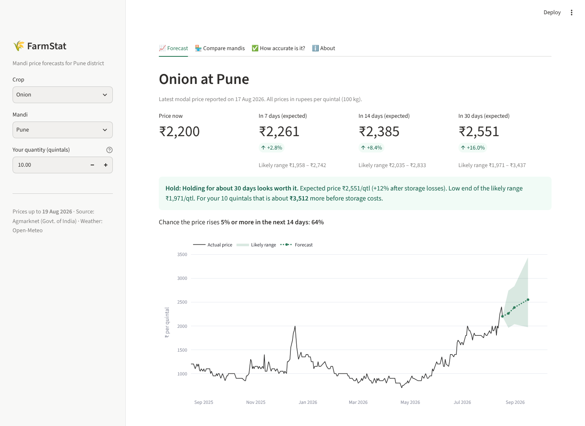
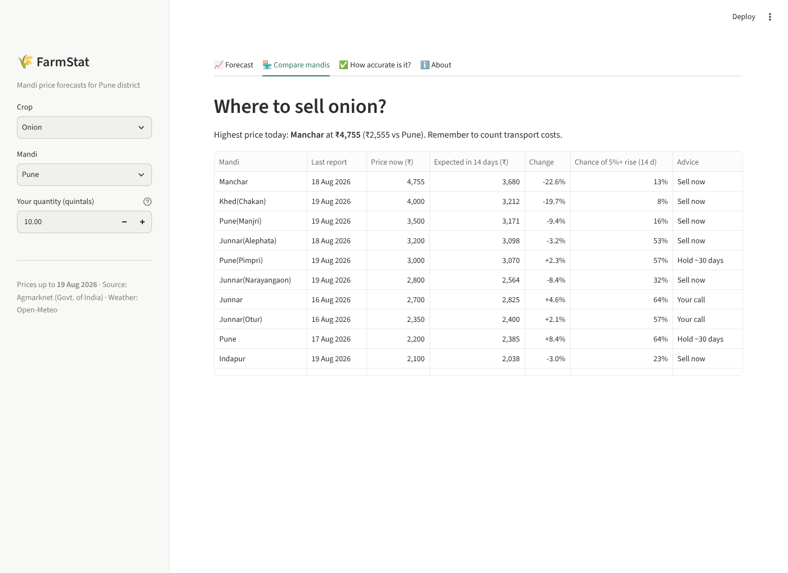
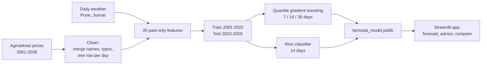
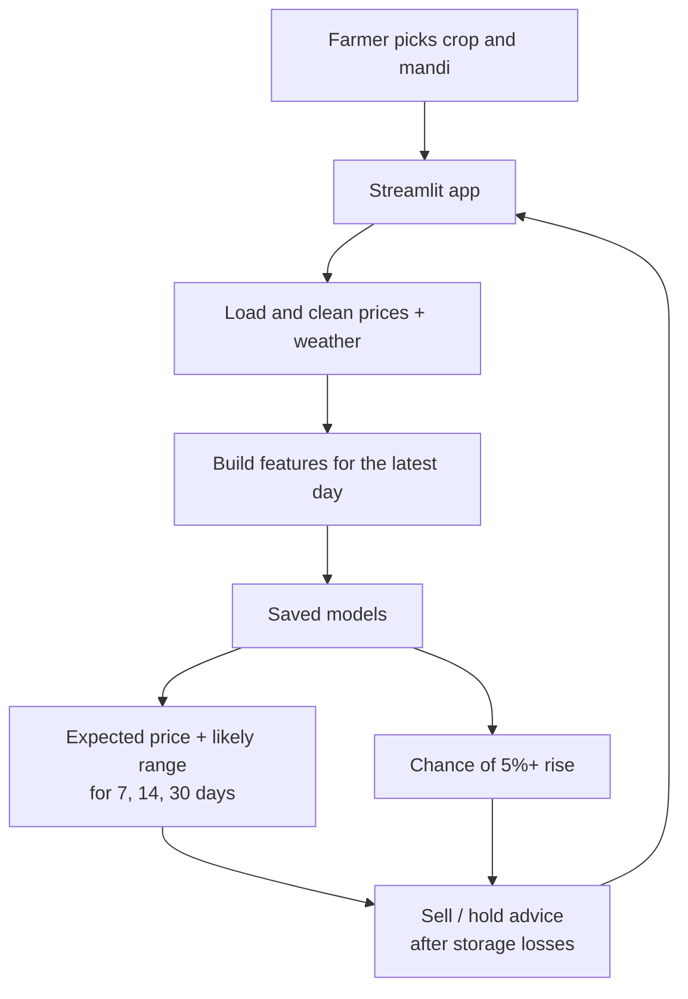

# FARMSTAT

Forecasts onion, tomato and potato prices in Pune-district mandis 7, 14 and 30 days ahead, and tells the farmer whether to sell now or hold.

<p align="center">
  
  
</p>

## CONTENTS

[About](#about) · [Results](#results) · [Features](#features) · [How the model was built](#how-the-model-was-built) ·
[Architecture](#architecture) · [Tech stack](#tech-stack) · [Getting started](#getting-started) ·
[Project structure](#project-structure) · [Data](#data) · [Status and limitations](#status-and-limitations)

## ABOUT

A farmer at the mandi has one big question: **sell today, or
wait?** Onion prices can double or halve within a month, and most farmers decide with no forecast at all.

FarmStat learns from **25 years of daily mandi prices** (Agmarknet, Government of India) and **daily weather** for
13 mandis in Pune district. For each crop and mandi it gives:

- the **expected price** in 7, 14 and 30 days
- a **likely price range**, not just one number
- the **chance of a 5%+ price rise** in the next two weeks
- simple **sell now / hold** advice that accounts for storage losses
- a **comparison of nearby mandis**, so the farmer can see which one pays the most

## RESULTS

All results are from a **hold-out test on January 2023 – August 2026**. The models never saw this data while being
trained or tuned. The period includes the July 2023 tomato spike and the December 2023 onion export ban.

| Forecast | Average error | Error vs "no change" forecast | Up/down right | Range contains real price |
|---|---|---|---|---|
| 7 days | ₹248 / quintal (14.5%) | **8.5% lower** | 70% | 80% |
| 14 days | ₹323 / quintal (18.3%) | **9.7% lower** | 69% | 76% |
| 30 days | ₹436 / quintal (24.6%) | **18.2% lower** | 70% | 66% |

| Other checks | Result |
|---|---|
| Walk-forward validation, 2018–2022 (14 days) | beats "no change" in every year: +4.4% to +10.9% |
| Price-rise classifier (5%+ in 14 days) | ROC-AUC 0.727. When it says 60%+ chance, a rise followed **69%** of the time, vs 39% on an average day |
| Farmer back-test (sell now vs follow the advice, after storage losses) | **+₹47 / quintal onion, +₹57 tomato, +₹23 potato**. Always holding *loses* money |

Beating "the price won't change" is hard in a market. It is the test most price-prediction projects skip, and
FarmStat passes it across every horizon, year and crop.


## FEATURES

- Pick a crop and a mandi to see today's price, the 7/14/30-day forecast and a chart of the last year with the forecast range
- Sell / hold advice that subtracts storage losses (onion 4%, potato 3%, tomato 15% per month)
- Never advises holding tomatoes for more than 7 days, because they spoil
- Shows the money involved for your quantity in quintals
- Compare-mandis tab: price now, expected price and advice for every mandi trading that crop
- Accuracy tab with the test results, so users can see how far to trust the forecasts

## HOW THE MODEL WAS BUILT

Everything is in [`notebooks/FarmStat_Training.ipynb`](notebooks/FarmStat_Training.ipynb), which is saved with all its outputs.

| Step | What was done | Concept |
|---|---|---|
| Cleaning | Merged duplicate mandi names (`Pune(Manjri) APMC` = `Pune(Manjri)`), one row per day, removed 233 typos (e.g. ₹75,000 onion) while keeping real spikes | Preprocessing, outliers |
| EDA | Price history with major shocks, seasonal pattern by month, volatility per crop, correlation between mandis | EDA |
| Features | 35 inputs from past data only: price changes over 1–365 days, position vs moving averages, volatility, district-wide trend, season, rainfall and its anomaly, temperature, humidity | Feature engineering |
| Validation | Time-based split (train 2001–2022, test 2023–2026), purged overlap, walk-forward CV by year | Time-series validation |
| Classic models | Linear, Ridge, Lasso, KNN, Decision Tree, SVR vs naive and moving-average baselines | Classic models |
| Ensembles | Random Forest, Gradient Boosting, XGBoost; GridSearchCV over 12 settings × 5 walk-forward folds | Ensembles, tuning |
| PCA | 19 of 33 numeric features keep 95% of the variance; PCA + Ridge comparison | Dimensionality reduction |
| K-Means | 5 market "regimes" (calm, choppy, spike, falling, crash); after a spike prices fall back, after a crash they recover | Clustering |
| Classifier | Logistic Regression, Random Forest, Gradient Boosting for "5%+ rise in 14 days"; confusion matrix, ROC, calibration | Classification |
| Ranges | Quantile gradient boosting (10th / 50th / 90th percentile) with coverage check | Uncertainty |
| Evaluation | MAE, MAPE, skill vs naive, direction accuracy, per crop / year / mandi, two case studies, farmer back-test, permutation importance | Metrics |

**Final model:** tuned Histogram Gradient Boosting with quantile loss (3 horizons × 3 quantiles), plus a gradient
boosting classifier for price rises, re-trained on all data up to August 2026.



## ARCHITECTURE



## TECH STACK

<p align="center">
  
  
  
  
  
  
</p>

| Layer | Technology |
|---|---|
| Models | scikit-learn (HistGradientBoosting, quantile loss), joblib |
| Training | Jupyter, pandas, NumPy, XGBoost, matplotlib, seaborn |
| App | Streamlit, Plotly |
| Tests | pytest |

## GETTING STARTED

You need **Python 3.11+**.

```bash
git clone https://github.com/Iamshi-vissa/FarmStat.git
cd FarmStat
python -m venv .venv
source .venv/bin/activate            # Windows: .venv\Scripts\activate
pip install -r requirements.txt
streamlit run app.py
```

Open <http://localhost:8501>. The data and the trained model (4 MB) are included, so the app works straight away.

### RETRAIN THE MODEL

```bash
pip install -r requirements-train.txt
jupyter notebook notebooks/FarmStat_Training.ipynb    # Run All, about 8 minutes
```

### RUN THE TESTS

```bash
pytest
```

The tests check that mandi names merge, that typos are removed while real spikes are kept, that features use only past
data (changing a future price must not change today's features), and that forecasts and advice are sane.

### DEPLOY

Push the repo to GitHub, then create an app on [Streamlit Community Cloud](https://streamlit.io/cloud) pointing at
`app.py`. It's free.

## PROJECT STRUCTURE

```
app.py                              Streamlit app
src/farmstat/data.py              load and clean prices and weather
src/farmstat/features.py          35 leakage-free features and the 7/14/30-day targets
src/farmstat/forecast.py          loads the models, forecasts, sell/hold advice
models/farmstat_model.joblib      trained models
models/metrics.json                 test results
notebooks/FarmStat_Training.ipynb full training and validation (with outputs)
figures/                            charts from the notebook
data/raw/                           onion, tomato, potato prices (Agmarknet)
data/weather/                       daily weather for Pune and Junnar (Open-Meteo)
tests/                              pytest tests
```

## DATA

| Data | Source | Coverage |
|---|---|---|
| Daily modal / min / max prices | [Agmarknet](https://agmarknet.gov.in), Directorate of Marketing & Inspection, Government of India (Open Government Data License – India) | Onion, tomato, potato · 13 mandis in Pune district · 2001 – Aug 2026 · 74,721 clean rows |
| Daily weather | [Open-Meteo](https://open-meteo.com) historical weather API (CC BY 4.0) | Pune and Junnar · 2001 – 2026 |

The CSV extracts were compiled by the [harvest-advisory-system](https://github.com/chinmayjain07/harvest-advisory-system) project.

## STATUS AND LIMITATIONS

- **Markets are hard to predict over a few days.** The gain over "no change" is about 9% at 7–14 days and 18% at 30 days.
  That is useful, but it's not a crystal ball.
- **Government decisions can't be foreseen.** Export bans and duties move prices overnight, as the December 2023 onion
  ban showed in the case study.
- **The 30-day range is too narrow.** It contains the real price about 2 times in 3 instead of 4 in 5, because
  2023–2026 was more volatile than earlier years. Widening it with conformal calibration is the next fix.
- **Arrival volumes are not used yet.** The quantity of produce reaching the mandi is a major price driver and the most
  valuable next feature to add.
- **Only Pune district, three crops.** The pipeline works for any Agmarknet crop and district: add the CSVs to `data/raw/`
  and re-run the notebook.

## LICENSE

MIT. See [LICENSE](LICENSE).
