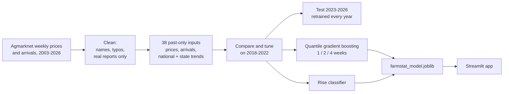
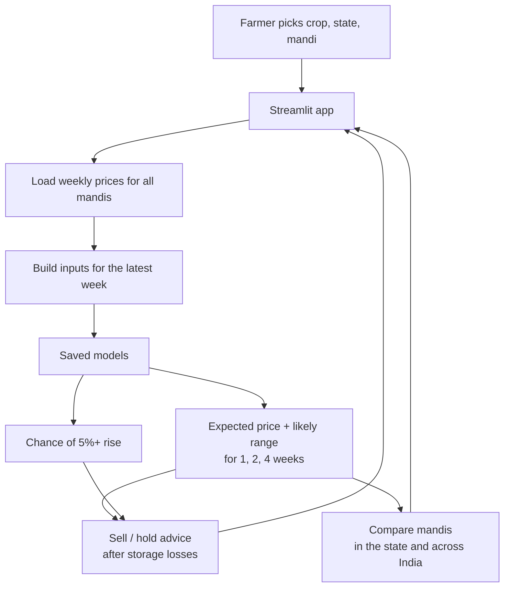

# FARMSTAT

Forecasts onion, tomato and potato prices in 870+ mandis across 24 Indian states, 1, 2 and 4 weeks ahead, and tells the farmer whether to sell now or hold.

<p align="center">
  
  
</p>

## CONTENTS

[About](#about) · [Results](#results) · [Features](#features) · [How the model was built](#how-the-model-was-built) ·
[Architecture](#architecture) · [Tech stack](#tech-stack) · [Getting started](#getting-started) ·
[Project structure](#project-structure) · [Data](#data) · [Status and limitations](#status-and-limitations)

## ABOUT

A farmer at the mandi has one big question: **sell this week, or wait?** Onion and tomato prices can double or
halve within a month, and most farmers decide with no forecast at all.

FarmStat learns from **23 years of weekly mandi prices and arrivals** (Agmarknet, Government of India): 625,000
weekly reports from about 980 mandis in 24 states. For each crop and mandi it gives:

- the **expected price** in 1, 2 and 4 weeks
- a **likely price range**, not just one number
- the **chance of a 5%+ price rise** in the next two weeks
- simple **sell now / hold** advice that accounts for storage losses
- a **comparison of mandis in the same state and across India**

## RESULTS

The final test covers **January 2023 to July 2026**. The model was **re-trained at the start of each year** on past
data only, exactly as it would be in use, and these years were never used to make any modelling choice.

| Forecast | Average error | Error vs "no change" forecast | Up/down right | Range contains real price |
|---|---|---|---|---|
| 1 week | ₹256 / quintal (10.8%) | **7.7% lower** | 67% | 79% |
| 2 weeks | ₹395 / quintal (16.6%) | **8.0% lower** | 67% | 74% |
| 4 weeks | ₹618 / quintal (27.1%) | **6.5% lower** | 66% | 67% |

| 2-week forecast by segment | Error vs "no change" |
|---|---|
| Onion, established mandis | 8.4% lower |
| Tomato, established mandis | 10.6% lower |
| Potato, established mandis | 11.8% lower |
| Tomato, new mandis (reporting since 2020+) | 6.2% lower |
| Onion, new mandis (reporting since 2020+) | 2.9% *higher*: hard to beat, flagged in the app |

| Other checks | Result |
|---|---|
| Price-rise classifier (5%+ in 2 weeks) | ROC-AUC 0.746. When it says 60%+ chance, a rise followed **67%** of the time, vs 35% in an average week |
| Farmer back-test (sell now vs follow the advice, after storage losses) | **+₹22 / quintal onion, +₹44 tomato, +₹11 potato**. Always holding *loses* money |

"The price won't change" is a hard benchmark in any market. FarmStat beats it overall at every horizon, and in every
year from 2023 to 2026 for the 2-week forecast. The one segment where it doesn't, onion in recently added mandis, is shown openly, and the app
warns users there.


## FEATURES

- Pick a crop, a **state** and a **mandi** to see this week's price, the 1/2/4-week forecast and two years of history
  with the forecast range
- Sell / hold advice that subtracts storage losses (onion 4%, potato 3%, tomato 15% per 4 weeks)
- Never advises holding tomatoes for more than a week, because they spoil
- Shows the money involved for your quantity in quintals
- Arrivals chart for every mandi
- Compare tab with every mandi in the chosen state, the median price in each state, and the highest-paying mandis in India
- Warning on mandis with less than 3 years of history
- Accuracy tab with the test results, so users can see how far to trust the forecasts

## HOW THE MODEL WAS BUILT

Everything is in [`notebooks/FarmStat_Training.ipynb`](notebooks/FarmStat_Training.ipynb), which is saved with all its outputs.

| Step | What was done | Concept |
|---|---|---|
| Cleaning | Standardised mandi names (`APMC Azadpur` = `Azadpur`), merged Kerala/Keralam, real reports only, removed 424 typo weeks while keeping real spikes | Preprocessing, outliers |
| EDA | National price history with major shocks, number of mandis per year (the source added hundreds in 2024–25), seasonality, state price gaps, **arrivals vs next price change** | EDA |
| Features | 38 inputs from past data only: price changes over 1–52 weeks, moving averages, volatility, **arrivals** and their change vs usual, national and state trends, the mandi's usual premium, history length, season | Feature engineering |
| Validation | Compare models on 2022, GridSearch on 4 walk-forward folds, tune shrinkage on 2019–2022, final test on 2023–2026 with yearly retraining | Time-series validation |
| Classic models | Linear, Ridge, Lasso, KNN, Decision Tree, SVR vs naive and moving-average baselines | Classic models |
| Ensembles | Random Forest, Gradient Boosting, XGBoost; GridSearchCV over 8 settings × 4 folds | Ensembles, tuning |
| PCA | 23 of 36 components keep 95% of the variance; PCA + Ridge comparison | Dimensionality reduction |
| K-Means | 4 market regimes (calm, choppy, spike, crash) chosen with elbow + silhouette | Clustering |
| Classifier | Logistic Regression, Random Forest, Gradient Boosting for "5%+ rise in 2 weeks"; confusion matrix, ROC, calibration | Classification |
| Shrinkage | Forecasts pulled towards "no change" by a factor tuned on 2019–2022 | Regularisation |
| Ranges | Quantile gradient boosting (10th / 50th / 90th percentile) with coverage check | Uncertainty |
| Evaluation | MAE, MAPE, skill vs naive, direction accuracy; by crop, mandi type, year and state; two case studies (Kolar tomato 2023, Lasalgaon onion export ban); farmer back-test; permutation importance | Metrics |

**Final model:** Histogram Gradient Boosting with quantile loss (3 horizons × 3 quantiles), plus a gradient-boosting
classifier for price rises, re-trained on all data up to July 2026.



## ARCHITECTURE



## TECH STACK

<p align="center">
  
  
  
  
  
  
</p>

| Layer | Technology |
|---|---|
| Models | scikit-learn (HistGradientBoosting, quantile loss), joblib |
| Training | Jupyter, pandas, NumPy, XGBoost, matplotlib, seaborn |
| App | Streamlit, Plotly |
| Tests | pytest |

## GETTING STARTED

You need **Python 3.11+**.

```bash
git clone https://github.com/Iamshi-vissa/FarmStat.git
cd FarmStat
python -m venv .venv
source .venv/bin/activate            # Windows PowerShell: .\.venv\Scripts\Activate.ps1
pip install -r requirements.txt
streamlit run app.py
```

Open <http://localhost:8501>. The data and the trained model are included. The **first start takes about a minute**
while forecasts are prepared for every mandi; after that the app opens instantly.

On Windows with more than one Python installed, use `py -3.12 -m venv .venv` to be sure you get the right one.

### RETRAIN THE MODEL

```bash
pip install -r requirements-train.txt
jupyter notebook notebooks/FarmStat_Training.ipynb    # Run All, about 25 minutes
```

### RUN THE TESTS

```bash
pytest
```

The tests check all-India coverage, that typos are removed while real spikes are kept, that inputs use only past data
(changing future prices must not change this week's inputs), and that forecasts and advice are sane.

### UPDATE THE DATA

`scripts/prepare_data.py` rebuilds `data/mandi_weekly.csv.gz` from the source weekly panel (see [Data](#data)).

### DEPLOY

Push the repo to GitHub, then create an app on [Streamlit Community Cloud](https://streamlit.io/cloud) pointing at
`app.py`. It's free.

## PROJECT STRUCTURE

```
app.py                              Streamlit app
src/farmstat/data.py                load and clean the weekly prices
src/farmstat/features.py            38 leakage-free inputs and the 1/2/4-week targets
src/farmstat/forecast.py            loads the models, forecasts, shrinkage, sell/hold advice
models/farmstat_model.joblib        trained models
models/metrics.json                 test results
notebooks/FarmStat_Training.ipynb   full training and validation (with outputs)
figures/                            charts from the notebook
data/mandi_weekly.csv.gz            625,157 weekly reports, 24 states, ~980 mandis
scripts/prepare_data.py             builds the data file from the source panel
tests/                              pytest tests
```

## DATA

| Data | Source | Coverage |
|---|---|---|
| Weekly modal price (arrival-weighted) and arrivals | [Agmarknet](https://agmarknet.gov.in), Directorate of Marketing & Inspection, Government of India (Open Government Data License – India) | Onion, tomato, potato · 24 states · ~980 mandis · Jan 2003 – Jul 2026 |

The weekly panel was compiled from Agmarknet by the [TOP Digital Twin](https://github.com/masroor01/TOP-Digital-Twin)
project. FarmStat keeps only real (non-imputed) weekly reports.

## STATUS AND LIMITATIONS

- **Markets are hard to predict week to week.** The gain over "no change" is about 7–8%. That is useful, but it's not a
  crystal ball.
- **New mandis are the hardest.** Hundreds of mandis joined the data in 2024–25. With little history and sticky prices,
  onion forecasts there do not beat "no change"; the app marks these mandis and keeps their forecasts close to today's price.
- **Government decisions can't be foreseen.** Export bans and duties move prices overnight, as the Lasalgaon case study
  shows.
- **The 4-week range is too narrow.** It contains the real price about 2 times in 3 instead of 4 in 5. Widening it with
  conformal calibration is the next fix.
- **Potato covers only 72 mandis, in West Bengal and Uttarakhand** — the source panel only includes potato for these two states.
- **Weather is not used.** Rainfall data for every mandi's district would be a natural next input.

## LICENSE

MIT. See [LICENSE](LICENSE).
