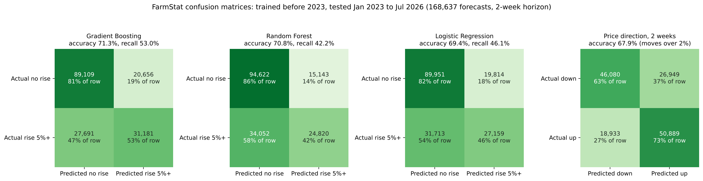

# FarmStat: Models, Learning Methods and Algorithms

**Vamshi Bharath Vissa** (20241CSE1097), School of Computer Science and Engineering, Presidency University, Bengaluru

This report lists every machine-learning model used in FarmStat, the type of learning each one belongs to, how it was
set up, and how well it did. The full write-up of the project, in IEEE format, is in
[FarmStat_Report.pdf](FarmStat_Report.pdf). The code is in `notebooks/FarmStat_Training.ipynb` (exploration and model
choice), `scripts/retrain.py` (the production models) and `scripts/evaluate.py` (the independent test).

## 1. The problem in machine-learning terms

| Question a farmer asks | ML task | Target | Models |
|---|---|---|---|
| What will the price be in 1, 2 and 4 weeks? | Supervised regression | Log price change, `ln P(t+h) − ln P(t)` | Gradient boosting (median) |
| How far could it move? | Quantile regression | 10th and 90th percentiles of the change | Gradient boosting (quantile loss) + conformal calibration |
| Will it rise 5% or more in 2 weeks? | Supervised binary classification | 1 if the 2-week change is at least +5% | Gradient-boosting classifier |
| What state is the market in? | Unsupervised clustering | (none: no label) | K-Means |
| Which inputs carry the signal? | Unsupervised dimensionality reduction | (none) | PCA |
| Sell now or hold? | Decision rule on top of the models | Expected gain after storage losses | Rule using the forecasts and the rise chance |

**Data:** an Agmarknet weekly panel of 622,763 rows: 1,414 crop–mandi series of onion, tomato and potato in 922
mandis across 24 states, January 2003 to July 2026, plus 47 arecanut mandi-variety series from Karnataka and Kerala.
Each row is one mandi in one week, with the arrival-weighted modal price (₹ per quintal) and arrivals (tonnes).

**Inputs:** 38 features, each computed only from data available by the end of the forecast week (no look-ahead):
18 on the mandi's own price history (changes over 1 to 52 weeks, distance from moving averages, volatility, how
regularly it reports), 7 on arrivals, 8 on national and state markets, 3 on the season and 2 categories (crop, state).

## 2. Types of learning used

| Type of learning | Where it is used in FarmStat |
|---|---|
| **Supervised learning, regression** | Price-change forecasts at 1, 2 and 4 weeks; the model comparison of Section 3 |
| **Supervised learning, classification** | The 5%-rise warning; Logistic Regression, Random Forest and Gradient Boosting compared |
| **Unsupervised learning, clustering** | K-Means groups mandi-weeks into market regimes (crash, choppy, calm, spike) to describe the market |
| **Unsupervised learning, dimensionality reduction** | PCA on the numeric features, and Ridge regression on the components |
| **Ensemble learning: bagging** | Random Forest (regressor and classifier) |
| **Ensemble learning: boosting** | Gradient Boosting (scikit-learn HistGradientBoosting) and XGBoost; boosting is the final model |
| **Instance-based learning** | K-Nearest Neighbours regression (k = 50) |
| **Kernel methods** | Support Vector Regression with an RBF kernel |
| **Regularised linear models** | Ridge (L2) and Lasso (L1) regression |
| **Quantile (distribution) regression** | Pinball-loss gradient boosting at the 10th, 50th and 90th percentiles |
| **Conformal prediction** | Split-conformal widening of the forecast ranges, learned from earlier years |
| **Hyperparameter tuning** | GridSearchCV over 8 settings with 4 walk-forward folds (2018–2021) |
| **Time-series validation** | Walk-forward (expanding window) training and testing, retrained every year |
| **Continual learning** | Weekly retraining on new live data, with a champion-versus-challenger check before a new model is used |

## 3. Regression models compared

All candidates were trained on data up to 2021 and compared on 2-week forecasts for 2022. *Skill* is the reduction in
mean absolute error against the naive "no change" forecast; *direction* is the share of correct up or down calls.

| Model | Family | Settings | MAE (₹/q) | Skill | Direction |
|---|---|---|---|---|---|
| Gradient boosting (HGB) | Boosted trees | absolute-error loss, 300 iterations, l2 = 1.0 | 330 | 11.4% | 68.7% |
| Ridge regression | Linear, L2 | α = 10, scaled inputs, one-hot crop and state | 331 | 11.1% | 68.4% |
| Linear regression | Linear | ordinary least squares | 331 | 11.1% | 68.4% |
| Lasso | Linear, L1 | α = 0.0005 | 331 | 11.1% | 68.5% |
| Random forest | Bagged trees | | 332 | 10.9% | 68.6% |
| KNN | Instance-based | k = 50, scaled inputs | 332 | 10.8% | 67.3% |
| SVR | Kernel | RBF kernel, C = 0.3, ε = 0.05 | 332 | 10.7% | 66.5% |
| Gradient boosting, tuned | Boosted trees | learning rate 0.03, 15 leaves, 1,000 rows per leaf | 333 | 10.5% | 67.8% |
| XGBoost | Boosted trees | 400 trees, learning rate 0.05, depth 6, subsample 0.8 | 343 | 7.8% | 65.9% |
| Decision tree | Single tree | depth 8, 200 rows per leaf | 355 | 4.6% | 64.9% |
| Naive (no change) | Baseline | next week = this week | 372 | 0.0% | – |
| 13-week moving average | Baseline | | 737 | −98.1% | 48.8% |

**What this showed.** Every learner except the moving average beat the naive forecast. The linear models came close
to gradient boosting, so most of the signal is in the engineered features. Histogram gradient boosting was chosen for
production because it supports quantile loss, handles missing values and the crop and state categories natively, and
trains on 600,000 rows in seconds. The tuned settings (learning rate 0.03, 15 leaves, at least 1,000 rows per leaf)
were picked by GridSearchCV on 2018–2021 and kept even though they scored slightly lower on 2022, because choosing on
the comparison year would have been overfitting to it.

## 4. The production model

- **Algorithm:** scikit-learn `HistGradientBoostingRegressor`, one model per horizon (1, 2, 4 weeks) and per quantile
  (0.1, 0.5, 0.9): nine models, all trained on every mandi together (a pooled, global model).
- **Settings:** learning rate 0.03, 15 leaves per tree, at least 1,000 rows per leaf, 300 boosting iterations, L2
  regularisation 1.0, crop and state as native categorical features, random seed 42.
- **Shrinkage:** the median forecast is multiplied by 0.8 (pulled towards "no change"), a regularisation step tuned on
  2019–2022, because weekly prices are noisy.
- **Calibration:** the 10th and 90th percentile ends are widened by split-conformal prediction, using the forecast
  errors of up to three earlier years, so that 80% of real prices fall inside the range.
- **Rise warning:** `HistGradientBoostingClassifier` (learning rate 0.05, 31 leaves, 500 rows per leaf, 300
  iterations) predicts the chance of a rise of at least 5% within two weeks.
- **Advice rule:** "hold" when the best expected gain after storage losses (onion 4%, potato 3%, tomato 15% per four
  weeks) is at least 4% and either the horizon is one week or the rise chance is at least 50%; "sell now" when the
  1-week forecast is 3% or more below today or nothing gains; otherwise "your call".

## 5. Classification models compared (5%+ rise in 2 weeks)

Trained on 2003–2022, tested on 2023–2026.

| Model | Type | ROC-AUC | Accuracy | Precision | Recall | F1 |
|---|---|---|---|---|---|---|
| Gradient boosting | Boosted trees | 0.746 | 0.713 | 0.602 | 0.530 | 0.563 |
| Random forest | Bagged trees (150 trees) | 0.731 | 0.708 | 0.621 | 0.422 | 0.502 |
| Logistic regression | Linear, C = 0.3 | 0.711 | 0.694 | 0.578 | 0.461 | 0.513 |
| Always "no rise" | Baseline | 0.500 | 0.651 | – | 0.000 | – |

### Confusion matrices

The same split (trained before 2023, tested on 168,637 two-week forecasts from January 2023 to July 2026), recomputed
by `scripts/confusion_matrices.py` (numbers in `reports/confusion_matrices.json`). A rise is called when the
probability is 0.5 or more. 58,872 of the test weeks (34.9%) rose by 5% or more. TN and TP are correct "no rise" and
"rise" calls, FP a rise called that didn't come (a false alarm), FN a rise that was missed. Specificity is the share
of non-rises correctly called.

| Model | True negatives (TN) | False positives (FP) | False negatives (FN) | True positives (TP) |
|---|---|---|---|---|
| Gradient boosting | 89,109 | 20,656 | 27,691 | 31,181 |
| Random forest | 94,622 | 15,143 | 34,052 | 24,820 |
| Logistic regression | 89,951 | 19,814 | 31,713 | 27,159 |
| Always "no rise" | 109,765 | 0 | 58,872 | 0 |

| Model | Accuracy | Precision | Recall | Specificity | F1 | ROC-AUC |
|---|---|---|---|---|---|---|
| Gradient boosting | 71.3% | 60.2% | 53.0% | 81.2% | 0.563 | 0.746 |
| Random forest | 70.8% | 62.1% | 42.2% | 86.2% | 0.502 | 0.731 |
| Logistic regression | 69.4% | 57.8% | 46.1% | 81.9% | 0.513 | 0.711 |
| Always "no rise" | 65.1% | – | 0.0% | 100% | 0 | 0.500 |

Gradient boosting catches the most real rises (53%) while keeping false alarms to 19% of the weeks that didn't rise,
which is why it is the one in the app. Random forest is the most cautious: fewest false alarms, but it misses 58% of
rises.

**Direction of the price forecast.** The production regressor's settings, same split, counting only the 142,851
weeks where the price moved more than 2%:

| | Predicted down | Predicted up | Recall |
|---|---|---|---|
| **Actually went down** | 46,080 | 26,949 | 63.1% |
| **Actually went up** | 18,933 | 50,889 | 72.9% |
| **Precision** | 70.9% | 65.4% | Accuracy 67.9% |

(In the walk-forward test, retrained every year, direction accuracy was 67.1% at two weeks.)

In the independent re-run the gradient-boosting classifier had a ROC-AUC of 0.73 and a Brier score of 0.193, against
0.227 for always quoting the 35% base rate, and its probabilities matched observed frequencies closely.

## 6. Unsupervised learning

**PCA.** On the numeric features, 23 of 36 principal components keep 95% of the variance. Ridge regression on the
components scored a skill of 4.8% with 3 components and 8.2% with 10 or 23, below Ridge on the original features
(11.1%), so PCA was used to understand the features, not in production.

**K-Means.** Mandi-weeks were clustered on 4-week and 13-week momentum, distance from the 13-week average, volatility
and arrivals against usual, with k chosen by the elbow and silhouette methods (k = 4):

| Regime | Share of weeks | Average change over the next 2 weeks | Chance of a 5%+ rise |
|---|---|---|---|
| Crash (far below average) | 20.7% | +0.8% | 38.3% |
| Choppy / volatile | 13.3% | +0.1% | 40.8% |
| Calm / normal | 48.4% | +0.4% | 35.8% |
| Spike (far above average) | 17.6% | −0.5% | 40.8% |

The regimes describe the market well but say little about the next two weeks on their own, which is why the
supervised models are needed.

## 7. How the models were validated

- **Model choice** on 2022 only; **tuning** on four walk-forward folds (2018–2021).
- **Final test** from January 2023 to July 2026, about 170,000 forecasts per horizon, retraining at the start of each
  year on everything before it, as in real use. These years were never used for any choice.
- **Statistics:** Diebold–Mariano test (Newey–West variance, Harvey–Leybourne–Newbold correction) for "is the gain
  real?", moving-block bootstrap for 95% intervals, ROC-AUC and Brier score for the classifier, and a reliability curve.
- **Run twice:** once in the notebook and once by `scripts/evaluate.py`, which rebuilds every model from scratch; the
  headline numbers agree.

| Horizon | MAE (₹/q) | Naive MAE | Skill | 95% interval | Diebold–Mariano p | Direction | Range held the price |
|---|---|---|---|---|---|---|---|
| 1 week | 256 | 278 | 7.7% | 4.8 to 10.4% | < 0.001 | 67.0% | 80.8% |
| 2 weeks | 395 | 429 | 8.0% | 3.6 to 12.2% | 0.006 | 67.1% | 79.8% |
| 4 weeks | 618 | 661 | 6.5% | 1.0 to 12.0% | 0.14 | 65.8% | 80.1% |

**Arecanut.** Neither the main model nor an arecanut-only model beat "no change" (skill −0.6% to −11.4%), so FarmStat
shows arecanut's current price with the range past weekly moves have covered (which held the price 77–79% of the time).

## 8. Libraries

scikit-learn 1.9 (all production models, PCA, K-Means, the classic models, GridSearchCV), XGBoost (comparison only),
pandas and NumPy (data and features), SciPy (statistical tests), matplotlib (charts).
