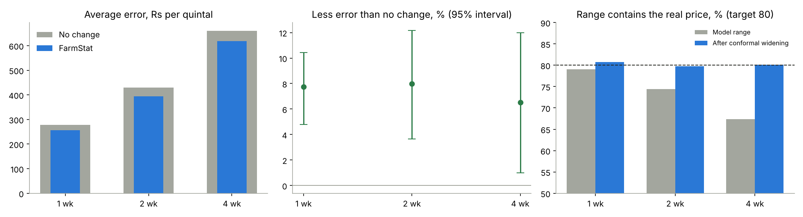
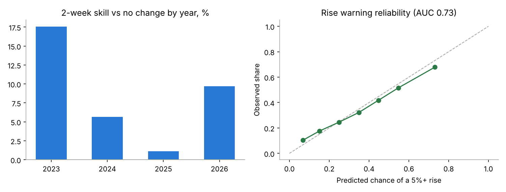

# FarmStat model evaluation

Model 2.1.1. Walk-forward test on 2023-2026: for each year the models were retrained on data whose outcome is known before 1 January of that year, then forecast every week of it. Onion, tomato and potato, all mandis. Generated by `scripts/evaluate.py`.

## At a glance

- **Beats "no change" at every horizon:** 7.7% less error at 1 week, 8.0% at 2 weeks, 6.5% at 4 weeks.
- **Not luck at 1 and 2 weeks:** Diebold-Mariano p = 2.3e-05 and 0.0065; at 4 weeks p = 0.14, so that gain could be chance.
- **Direction right about 2 times in 3:** 67.0%, 67.1%, 65.8%.
- **Ranges hold as promised after calibration:** 80.8%, 79.8% and 80.1% against an 80% target (the model's own ranges: 79.1%, 74.5%, 67.3%).
- **Rise warning:** ROC-AUC 0.73; Brier score 0.193 vs 0.227 for the base rate.
- **Following the advice paid:** +Rs 22/q onion, +Rs 44/q tomato, +Rs 11/q potato compared with always selling at once, after storage losses.

## Accuracy

| Horizon | Rows | Avg error (Rs/q) | No change (Rs/q) | Skill | 95% interval | RMSE (Rs/q) | Avg % error | Direction right | Range coverage | After conformal |
|---|---|---|---|---|---|---|---|---|---|---|
| 1 week | 171,072 | 256 | 278 | 7.7% | 4.8% to 10.4% | 467 | 10.8% | 67.0% | 79.1% | 80.8% |
| 2 weeks | 168,637 | 395 | 429 | 8.0% | 3.6% to 12.2% | 691 | 16.6% | 67.1% | 74.5% | 79.8% |
| 4 weeks | 164,797 | 618 | 661 | 6.5% | 1.0% to 12.0% | 1046 | 27.1% | 65.8% | 67.3% | 80.1% |

## Is the gain real? (Diebold-Mariano test vs no change)

| Horizon | Weeks | Mean error difference (Rs/q) | DM statistic | p-value |
|---|---|---|---|---|
| 1 | 186 | -25.1 | -4.34 | 2.3e-05 |
| 2 | 185 | -42.4 | -2.75 | 0.0065 |
| 4 | 183 | -59.3 | -1.49 | 0.14 |

A negative difference means FarmStat's error is lower. The test uses each week's average error across mandis, a Newey-West variance and the Harvey small-sample correction.

## Range calibration

| Horizon | Below 10th pct (target 10%) | Below median (target 50%) | Below 90th pct (target 90%) | Median range width, before -> after conformal |
|---|---|---|---|---|
| 1 | 11.6% | 50.3% | 90.7% | 32.2% -> 33.2% |
| 2 | 14.9% | 53.1% | 89.3% | 43.6% -> 47.9% |
| 4 | 19.5% | 55.5% | 86.8% | 56.8% -> 71.2% |

Recalibrated ranges: each test year's range is adjusted using only the out-of-sample errors of up to 3 earlier years: each end of the range moves by the amount that would have left 10% of outcomes outside it (split-conformal, one shift per tail).

## 2 weeks ahead by crop and mandi type

New = less than 3 years (156 weeks) of price history at the forecast date; established = the rest.

| Group | Rows | Avg error (Rs/q) | Skill | Direction | Coverage |
|---|---|---|---|---|---|
| Onion / established | 34,096 | 287 | 8.4% | 65.3% | 75.6% |
| Onion / new | 35,443 | 207 | -3.2% | 65.2% | 67.5% |
| Potato / established | 12,561 | 93 | 11.8% | 71.3% | 84.1% |
| Tomato / established | 66,934 | 532 | 10.6% | 68.6% | 76.2% |
| Tomato / new | 19,603 | 645 | 5.5% | 66.1% | 72.9% |

## By year (2 weeks ahead)

| Year | Rows | Avg error (Rs/q) | Skill | Direction | Coverage |
|---|---|---|---|---|---|
| 2023 | 33,250 | 464 | 17.6% | 71.0% | 76.2% |
| 2024 | 39,695 | 553 | 5.7% | 66.9% | 77.9% |
| 2025 | 64,100 | 318 | 1.1% | 64.3% | 69.0% |
| 2026 | 31,592 | 279 | 9.7% | 69.0% | 79.3% |

## Largest states (2 weeks ahead)

| State | Rows | Avg error (Rs/q) | Skill | Direction |
|---|---|---|---|---|
| Tamil Nadu | 28,501 | 484 | 1.5% | 65.5% |
| Uttar Pradesh | 22,121 | 306 | 12.3% | 68.7% |
| West Bengal | 19,817 | 243 | 13.5% | 72.3% |
| Kerala | 18,001 | 535 | 6.4% | 65.7% |
| Maharashtra | 13,443 | 345 | 5.6% | 63.9% |
| Punjab | 12,214 | 417 | 11.1% | 66.7% |
| Haryana | 11,923 | 371 | 11.7% | 67.9% |
| Odisha | 7,109 | 510 | 9.0% | 70.1% |
| Rajasthan | 5,479 | 376 | 11.6% | 67.3% |
| Gujarat | 5,286 | 466 | 9.4% | 67.2% |
| Himachal Pradesh | 4,440 | 474 | 11.7% | 66.6% |
| Madhya Pradesh | 4,343 | 273 | 7.0% | 66.1% |

## Rise warning (chance of a 5%+ rise in 2 weeks)

ROC-AUC 0.732. Brier score 0.1926 against 0.2272 for always predicting the base rate (34.9%).

| Predicted | Observed | Rows |
|---|---|---|
| 6.8% | 10.4% | 15,084 |
| 15.2% | 17.6% | 32,363 |
| 24.9% | 24.5% | 30,695 |
| 34.8% | 32.2% | 25,993 |
| 44.8% | 41.8% | 20,775 |
| 54.7% | 51.6% | 16,217 |
| 73.1% | 67.8% | 27,510 |

## Advice back-test (from the training notebook's test)

Extra rupees per quintal from following FarmStat's sell-or-hold call instead of always selling at once, after storage losses (onion 4%, potato 3%, tomato 15% over 4 weeks; tomato held at most 1 week).

| Crop | Extra (Rs/q) |
|---|---|
| Onion | +22 |
| Tomato | +44 |
| Potato | +11 |

## Arecanut

No model beat "no change" for arecanut, so the app shows today's price with its usual range of movement. Share of weeks that range held the real price:

| Horizon | Range held |
|---|---|
| 1 week | 77.2% |
| 2 weeks | 78.5% |
| 4 weeks | 79.3% |

Less error than "no change" (negative = worse), 2023-2026, retrained yearly:

| Model | 1 week | 2 weeks | 4 weeks |
|---|---|---|---|
| Main model (all crops) | -1.7% | -5.5% | -10.6% |
| Arecanut-only model | -0.6% | -4.9% | -11.4% |

