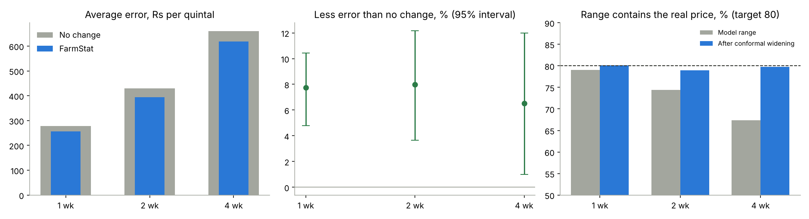
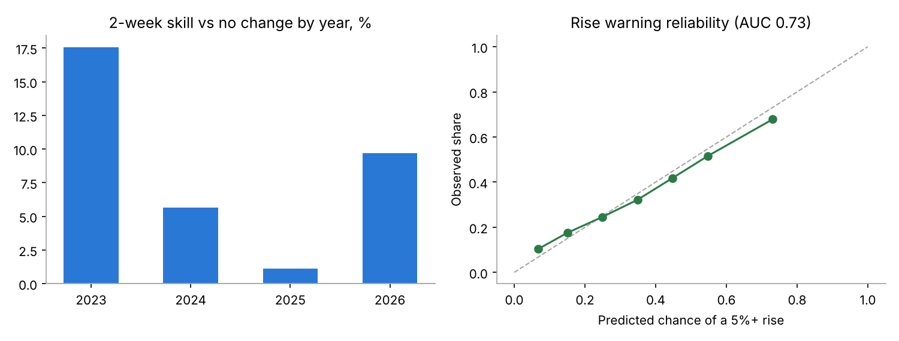

# FarmStat model evaluation

Model 2.1.0. Walk-forward test on 2023-2026: for each year the models were retrained on data whose outcome is known before 1 January of that year, then forecast every week of it. Onion, tomato and potato, all mandis. Generated by `scripts/evaluate.py`.

## Accuracy

| Horizon | Rows | Avg error (Rs/q) | No change (Rs/q) | Skill | 95% interval | Direction right | Range coverage | After conformal |
|---|---|---|---|---|---|---|---|---|
| 1 week | 171,072 | 256 | 278 | 7.7% | 4.8% to 10.4% | 67.0% | 79.1% | 80.1% |
| 2 weeks | 168,637 | 395 | 429 | 8.0% | 3.6% to 12.2% | 67.1% | 74.5% | 79.0% |
| 4 weeks | 164,797 | 618 | 661 | 6.5% | 1.0% to 12.0% | 65.8% | 67.3% | 79.8% |

## Is the gain real? (Diebold-Mariano test vs no change)

| Horizon | Weeks | Mean error difference (Rs/q) | DM statistic | p-value |
|---|---|---|---|---|
| 1 | 186 | -25.1 | -4.34 | 2.3e-05 |
| 2 | 185 | -42.4 | -2.75 | 0.0065 |
| 4 | 183 | -59.3 | -1.49 | 0.14 |

A negative difference means FarmStat's error is lower. The test uses each week's average error across mandis, a Newey-West variance and the Harvey small-sample correction.

## Range calibration

| Horizon | Below 10th pct (target 10%) | Below median (target 50%) | Below 90th pct (target 90%) | Median range width, before -> after conformal |
|---|---|---|---|---|
| 1 | 11.6% | 50.3% | 90.7% | 32.2% -> 33.0% |
| 2 | 14.9% | 53.1% | 89.3% | 43.6% -> 48.7% |
| 4 | 19.5% | 55.5% | 86.8% | 56.8% -> 74.4% |

Conformal widening: each test year's range is widened by the amount that made the previous year's out-of-sample ranges contain 80% of outcomes (split-conformal, CQR-style).

## 2 weeks ahead by crop and mandi type

New = less than 3 years (156 weeks) of price history at the forecast date; established = the rest.

| Group | Rows | Avg error (Rs/q) | Skill | Direction | Coverage |
|---|---|---|---|---|---|
| Onion / established | 34,096 | 287 | 8.4% | 65.3% | 75.6% |
| Onion / new | 35,443 | 207 | -3.2% | 65.2% | 67.5% |
| Potato / established | 12,561 | 93 | 11.8% | 71.3% | 84.1% |
| Tomato / established | 66,934 | 532 | 10.6% | 68.6% | 76.2% |
| Tomato / new | 19,603 | 645 | 5.5% | 66.1% | 72.9% |

## By year (2 weeks ahead)

| Year | Rows | Avg error (Rs/q) | Skill | Direction | Coverage |
|---|---|---|---|---|---|
| 2023 | 33,250 | 464 | 17.6% | 71.0% | 76.2% |
| 2024 | 39,695 | 553 | 5.7% | 66.9% | 77.9% |
| 2025 | 64,100 | 318 | 1.1% | 64.3% | 69.0% |
| 2026 | 31,592 | 279 | 9.7% | 69.0% | 79.3% |

## Largest states (2 weeks ahead)

| State | Rows | Avg error (Rs/q) | Skill | Direction |
|---|---|---|---|---|
| Tamil Nadu | 28,501 | 484 | 1.5% | 65.5% |
| Uttar Pradesh | 22,121 | 306 | 12.3% | 68.7% |
| West Bengal | 19,817 | 243 | 13.5% | 72.3% |
| Kerala | 18,001 | 535 | 6.4% | 65.7% |
| Maharashtra | 13,443 | 345 | 5.6% | 63.9% |
| Punjab | 12,214 | 417 | 11.1% | 66.7% |
| Haryana | 11,923 | 371 | 11.7% | 67.9% |
| Odisha | 7,109 | 510 | 9.0% | 70.1% |
| Rajasthan | 5,479 | 376 | 11.6% | 67.3% |
| Gujarat | 5,286 | 466 | 9.4% | 67.2% |
| Himachal Pradesh | 4,440 | 474 | 11.7% | 66.6% |
| Madhya Pradesh | 4,343 | 273 | 7.0% | 66.1% |

## Rise warning (chance of a 5%+ rise in 2 weeks)

ROC-AUC 0.732. Brier score 0.1926 against 0.2272 for always predicting the base rate (34.9%).

| Predicted | Observed | Rows |
|---|---|---|
| 6.8% | 10.4% | 15,084 |
| 15.2% | 17.6% | 32,363 |
| 24.9% | 24.5% | 30,695 |
| 34.8% | 32.2% | 25,993 |
| 44.8% | 41.8% | 20,775 |
| 54.7% | 51.6% | 16,217 |
| 73.1% | 67.8% | 27,510 |

